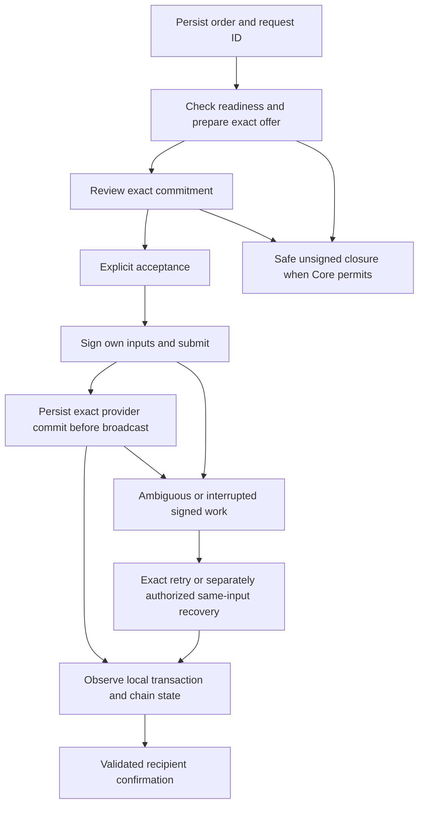

# Paymaster implementation

See [the developer guide](../PAYMASTER.md) for scope and documentation baseline.
The [client contract](digidollar-paymaster-integration.md) describes application use.

## Transaction and fee model

The result is an ordinary `DD_TX_TRANSFER`. The client supplies DD inputs and
the provider contributes DGB network-fee inputs. Each signs only its own inputs
after checking the complete transaction. Consensus and script checks remain
unchanged. There is one recipient; mint, redeem and batch sponsorship are absent.

Amounts are integer DD cents or DGB satoshis. Recipient bounds are
100..10,000,000 cents and user total is at most 10,000,000 cents. Provider terms
can narrow this range. The user-paid fee is rounded up:

```text
fee_cents = ceil(payment_cents * fee_rate_bps / 10000)
```

A positive `maximum_user_paid_service_fee_cents` caps that fee; zero means
uncapped by this provider setting. Independent client absolute, percentage
and rolling-day limits still apply. Public sponsorship charges zero DD fee.
Both models can be advertised by one identity with distinct offer IDs.

`GetProviderNetworkFee` supplies the current executable fee (0.1 DGB) for both
quote builders and readiness. A lower advertised cap cannot serve new work.
Readiness intersects each model's current safety budget with its own usable
pool resources: paid service needs DGB and carrier slots; sponsorship needs
DGB only. A carrier shortage in a mixed policy leaves sponsorship available.

A nonzero fee below the minimum DD output needs a confirmed provider DD carrier.
The provider receives carrier principal plus fee; the principal is not charged
to the client. Free sponsorship does not need a carrier for a service fee.
All resulting DD outputs must still satisfy ordinary validation.

`IsProviderCarrierUsable` uses `ComputeCarrierSuccessor` before new Capacity
binding. A positive fee rate requires headroom for every permitted sub-minimum
fee: 99 cents, or the smaller positive provider fee cap. Ordinary payment bounds
cannot reduce it because the same capacity serves aggregate recovery inputs.
Readiness, both slot selectors, `CountLiquiditySlots`, finite setup and refill
share this rule. A zero fee rate preserves the existing paid-pool requirement
without fee headroom. An already bound Capacity proof replays unchanged.
Full carriers remain protected; replacing them still requires the existing
funding approval, and withdrawal still requires its explicit approval.

Fee deduction treats the entered amount as the exact total. Rounded cent gaps
fail with `PAYMASTER_NO_EXACT_GROSS_OFFER`, rather than silently changing that
total. Sweep uses spendable, unreserved inputs and the same authorization rules.

## Protocol sequence

Announcements have one 64-KiB serialized byte ceiling, enforced by construction,
publication and peer intake. Funding parents are included in that ceiling;
oversized admission proofs report `PAYMASTER_ANNOUNCEMENT_TOO_LARGE` and cannot
start or refresh an active public offer. No automatic consolidation spend is
authorized by this failure. Display names are bounded before decoder allocation.

Authenticated Direct enqueue retains the local Core onion-transport
classification. High-privacy recovery uses that observation, including for
loopback onion forwarding and processing after disconnect. Unknown arrival
classification defers locally; it is not evidence of a non-onion connection.

1. Signed announcements enter a bounded directory. Clients filter amount,
   privacy, fee policy and local reliability information.
2. A dedicated Direct connection authenticates the expected provider against
   the local encrypted session, genesis and fresh challenge before revealing
   capacity/payment metadata.
3. Capacity admission precedes the full intent. Input-control proofs demonstrate
   control without authorizing the collaborative payment.
4. The exact quote binds provider, recipient, model, inputs/outputs, service
   fee, expiry and authorization commitment.
5. Explicit client acceptance permits signing/submission. The provider checks
   the exact manifest, authorization, inputs, budgets and transaction before
   signing its inputs and broadcasting.
6. Both parties reconcile local chain/mempool observations. Lost replies use
   durable replay/status, not another payment.

The shared PSBT/final validator checks the actual canonical 64-byte Taproot
key-path witness for `SIGHASH_DEFAULT`, even when the PSBT retains an explicit
default-sighash field. Metadata cannot override a final signature's hash mode.

Protocol version is 6; unchanged legacy Direct layouts accept version 5 only
where explicitly supported. Signed offers/negotiation use the current format.
Wallet record versions are independent of wire versions. Compatibility does
not permit substituting unauthenticated transport for required channel proofs.
Request IDs use the shared 36-byte UUID decoding limit in Direct, intent,
recovery and persisted authority records. Oversized lengths fail before string
allocation; valid V5/V6 and record serialization bytes are unchanged.
Announcements last up to 600 seconds; quote default/maximum is 60 seconds.
Remote timestamps share a checked 60-second positive clock-skew allowance,
including recovery envelopes, capacity observations and client acceptance of a
provider response. Local record chronology and expiry/signing deadlines remain
strict; this allowance never renews spending authority.
An announcement may become unavailable before expiry. Expiry does not prove
already signed spending authority harmless.

Offer comparisons share `OfferCandidateLess` in `src/paymaster/client.cpp`.
Within the selected policy, non-deprioritized offers precede deprioritized ones;
cost precedes sufficient reliability data, success rate, known/lower latency
and provider/offer IDs. Fixed-total comparisons use lower fee then higher
recipient amount. Unknown reliability/latency have explicit positions so sorting
remains a strict order for every input permutation.

## Endpoint diagnostics

`IsSupportedPaymasterEndpoint` defines the common IPv4/IPv6/Tor, nonzero-port
and routability contract for announcements, offers, restricted descriptors,
readiness, diagnostics and Direct connection admission. Regtest explicitly
permits loopback. Unsupported networks are rejected before connection work;
ordinary P2P keeps its existing network support and budgets.

Endpoint diagnostics are separate from authenticated payment channels.
`checkpaymasterendpoint` uses a locally selected `DirectPurpose::DIAGNOSTIC` key,
which cannot alias a payment/recovery lease. It records V2 and capability
negotiation and finishes with `TRANSPORT_READY`, never authenticated `READY`.
The sender and receive handlers prohibit authentication/application messages on
these connections. They share the existing connection quotas, deadlines and
SOCKS5 privacy rules; they never reserve wallet capital. See the
[RPC diagnostic instructions](digidollar-paymaster.md#start-and-verify-mainnet-operation).

## Durable state and recovery

Policies never initialize over missing spending history. Only absence of both
policy and ledger permits a fresh ledger; finite setup history is preserved
when recurring policy is enrolled later. Missing history beneath an existing
policy is unavailable, including during automatic refill and reconciliation.
Saving the same policy does not repair that state or reset its budgets.

The client persists a canonical request ID/order. New public orders also retain
an independently versioned `pmclientorder` replay record with the original fee
cap, selection, attempt limit, amount semantics and ordered inputs. Its hash and
session/intent bindings are validated before exposing `resume_order`; it grants
no acceptance or signing authority. Missing legacy or unreadable replay metadata
does not hide signed payment/recovery observations. Qt never reconstructs it from
compose defaults; existing integrations can still replay their saved exact arguments.
Identical concurrent retries join it; material changes using the same ID fail.
Sessions, reservations, exact
commit evidence, budgets and final observations are persisted with their state
transitions. Network/UI status alone must not release protected inputs.

`PaymasterStore::ReconcileClientPaymentHistory` is the shared display-history
operation for startup, result polling, local confirmation and recovery refresh/
retry. It requires an accepted payment state, a local non-abandoned transaction
and authenticated exact final bytes including its witness and session binding.
A stored final or a confirmed self-recovery alone never creates a recipient
send row. A history-write failure retains payment authority and can be retried.
`EraseUnsubmittedPaymasterSendHistory` removes only the exact legacy recipient
row when the corresponding wallet transaction is absent; unrelated history stays.

Client refresh shares normal and alternative-recovery result receipt with the
explicit result/retry operations. It authenticates and retains both inbox
families before local validation or index waits, durably commits the exact final
and fee accounting, then acknowledges the message. Receipt alone never signs,
submits or broadcasts; the explicit operations separately execute saved finals.
A GUI timeout can therefore continue collecting a late provider result without
restarting payment execution. Local failures preserve authenticated results
beyond their ordinary transport TTL.

Authorization-bearing transitions share
`CommitWithPaymasterAuthorizationProtection`: the mandatory
`WALLET_FLAG_PAYMASTER_AUTHORIZATION` downgrade fence is written in the same
`WalletBatch` transaction, then published to memory only after commit. This
includes the first alternative-provider recovery signature and exact final
replay repair. Existing checkpoint preparation/commit ordering remains intact.
Client unsigned cancellation and recovery expiry/pruning require readable, absent
independent authority records before releasing financial bindings; unknown
versions and read failures cannot substitute for absence.
The same session-wide check covers client quote expiry, unsigned abandonment
and fallback, including idempotent success paths and every historical attempt.
It also checks self/alternative recovery authority. Accepted unsigned terms and
authentic negative terminal results alone do not imply a payment signature.

Provider-only closure uses `CloseProviderAttempt` (including
`CancelProviderQuote` and `CloseExpiredProviderAttempt`) and
`CloseExpiredProviderRecovery`. `ValidateProviderUnsignedAttempt` and
`ValidateProviderUnsignedRecovery` authenticate the local identity, saved terms,
manifest and any USER-signed PSBT, then `ReleaseProviderUnsignedBindings`
atomically releases the exact budget binding. The pool inputs remain `RESERVED`
under the same commit key until the original signed capacity proof expires:
closing an unsigned quote cannot revoke that proof's resource exclusivity.
Capacity cleanup re-authenticates the closed owner and its unsigned authority,
then releases only that remaining hold before compacting the proof cache. A
closed owner may outlive pruned released-budget history; any nonreleased budget
row still vetoes release.

Fresh proof selection also requires the request's start time to be at or after
the resource's last availability update. This prevents a delayed or clock-skewed
request from backdating the next proof into the old proof's window. Requests
without an eligible resource defer without a signature or persisted admission;
exact authenticated cached replies retain their original bytes.

Normal `USER_SIGNED` expiry uses the quote deadline; `USER_PSBT_ACCEPTED` uses
`retry_until`. Recovery uses the earlier response/capacity deadline and retains
its USER-signed bytes with `expired=true`. A valid USER-only receipt or an
authenticated negative terminal result without a final permits provider closure;
provider-signature evidence, corrupt/future records and read failures retain the
bindings. Client liabilities are unaffected. Closed recovery cannot advance
through `UpdateAlternativeRecovery`, pre-signature authorization or
`CommitProviderAlternativeRecoveryFinal`; exact committed-final replay is retained.
Provider closure and unsigned pruning require the restore guard to pass before
any release. A quarantined snapshot cannot prove absence of an external signature.
Repeated submits after local cancellation without a wire result receive a terminal
rejection; an authenticated saved negative result keeps its exact replay path.
Automatic `DRAIN_ONLY` dispatch continues admitted quotes, recovery requests and
exact cached capacity replies through `CONTINUING_ONLY`. Fresh capacity stays
deferred without changing runtime intent. Unlock, restore, policy, budget and
index gates still apply to each continuation; a scheduler state grants no spend.

The persisted quote is authenticated again before acceptance or signing through
`DecodePaymasterAuthorizationArtifacts`, shared with provider execution and
client final validation. It checks the provider signature, canonical encoding
and exact transaction/template bindings. Current approval and expiry checks
remain with the caller so intact historical final evidence stays verifiable.
Saved provider-signed result envelopes use the single domain decoder
`DecodeProviderSignedResultEnvelope` for store and execution validation.

Every new payment signature checks a fresh clock after acquiring the final
wallet lock. Local persisted authority and fee policy are reloaded there;
client signatures are persisted before releasing that lock. Chainstate/index
validation stays outside it. The role-limited signer checks the supplied
deadline again immediately before `FillPSBT`.
Fresh client acceptance and signatures use an exclusive quote/manifest expiry:
the expiry second cannot create new authority. The role-limited signer's
inclusive last-valid-second argument is derived from that same boundary.
Historical artifact validation and exact signed replay remain independent of
fresh quote expiry.

For normal provider payments, the first durable USER acceptance must precede
capacity expiry and be within the quote deadline. An exact accepted retry uses
the receipt's authenticated `accepted_at` for historical capacity validation,
and the current clock for `retry_until`, current wallet policy, budget, pool
bindings, manual locks and chain resources. This permits completing a timely
accepted payment after the short capacity TTL. Alternative recovery has no
equivalent durable provider receipt/retry window and still requires a current
response and capacity admission for every new provider signature.

Private Direct connections carry the existing destination-redaction policy
through TCP connection errors as well as SOCKS5 errors. Ordinary connection
logging retains its destination and unchanged socket behavior.

Normal and alternative-recovery client results use scoped inbox leases. Local
read, preflight or database failures retain the received artifact; acknowledgement
follows durable acceptance. Proven invalid remote envelopes are discarded without
releasing spending authority. A later broadcast failure uses the saved final bytes.
Unsigned recovery quotes also use scoped leases: local request damage, index,
template or persistence failures retain the reply; acknowledgement follows its
durable acceptance. Their ordinary quote/inbox expiry still applies. The extended
authenticated retention described below applies to complete signed results.
Persisted predecessor results and recovery authority are authenticated before
they can justify rejecting an incoming result. Payment and recovery use the shared
native `RetainAuthenticatedClientResult` operation before deeper local artifact
reads and validation. An intact accepted current manifest and its local identity
bindings can authenticate retention while the separately stored quote, PSBT or
capacity data is damaged. This does not grant financial authority: complete local
authorization, remote-artifact and chainstate checks still precede acceptance or
execution. Unknown manifest versions and unauthenticated replies gain no retention.
After authenticating the expected provider and the wallet's own commit binding,
the exact queue incarnation remains protected beyond the transport TTL, including
between failed processing calls. It still consumes the existing inbox byte/count
quotas. This retention is in memory; restart continues to rely on durable evidence
and the existing provider replay/recovery paths. Successful exact local payment
completion retires the leased response without accepting its remote status.
Subsequent polls repeat the canonical durable-artifact and current-confirmation
proof before retiring another obsolete response; a terminal state alone is insufficient.

Client unsigned cancellation closes only work proven unsigned. Late responses
cannot revive approval after closure. Signed or ambiguous client work remains
protected and exposes only Core-permitted actions. Cancel-to-self is an on-chain
recovery transaction, not an undo guarantee: the original transaction can still win.
Client recovery quote expiry applies to unsigned preparation. Client
`USER_SIGNED` and `FINAL_COMMITTED` remain observable and resumable through
Core-permitted actions after that deadline; Qt must not request fresh approval
for the saved signature.
`CompleteClientConfirmedFinal` is the common local observation operation used by
refresh, recovery resolution and bounded tip maintenance. A fully validated exact
alternative recovery at 240 confirmations can settle without a provider result:
spend its reserved fee, release original-attempt fee exposure and input locks,
and atomically prune into the existing `CANCELED_SAFE` request tombstone retaining
the recovery txid. No provider result, signature or broadcast is synthesized.
Before that depth, absence, reorg or invalid witnesses preserve signed authority;
failed persistence preserves all records and reservations.

Alternative recovery prices the aggregate original DD inputs and deducts its
fee from wallet-owned returns. The ordinary recipient-plus-fee ceiling does
not limit that aggregate; each return and fee output retains its ordinary DD
limits. Both parties use the same checked, rounded fee calculation. After the
canonical exact-final preflight, already spent recovery prevouts are supplied
only in a disposable reconstruction view. This requires an opaque, transient
proof bound to the exact transaction/witness, chainstate and observed tip;
presence enums or persisted bytes cannot manufacture it. A changed tip requires
a fresh preflight without holding the chain lock across index waits.
Full manifest and final-witness
validation remains mandatory; new signing still requires unspent inputs.
When a recovery result is missing, the client uses the same local final lookup
as ordinary submit retry. An exact wallet/mempool/chain transaction can supply
the transient proof after complete recovery-template and witness validation,
including after quote expiry. The client retries the persisted submit unchanged;
it retains `USER_SIGNED`, input protection and fee reservations until the
authenticated provider result is committed. Local presence is not a signed result.

Recovery fee exposure is retained through the 240-confirmation reorganization
safety depth. A winning original payment is accounted once. Retained exact
commit evidence can validate historical execution after rolling ledger entries
expire, without authorizing new work or recreating budget.
Reconciliation notifications schedule exact transaction identities; fresh wallet
observations under `cs_wallet` authorize state changes. Pruning checks those
observations again and commits original recovery-fee release together with the
tombstone and artifact deletion. Reorgs or failed writes retain both authority
and exposure. Direct replay callers pass depth one to defer safety-depth pruning
to tip reconciliation. Exact current stempool membership counts as accepted
network presence, using the wallet's existing mempool/stempool semantics; it
never supplies confirmation depth.
Wallet callbacks may lag a reorg. Pruning also binds the wallet tip and confirmed
block to the active chain and holds `cs_main` through the fee/tombstone commit.
A stale wallet tip defers pruning without releasing signed authority or fees.

Normal provider sessions and active alternative provider recoveries share an admission
limit of 8,192 records. Exact existing retries do not consume another
record. Each cleanup pass removes at most 64 eligible provider-unsigned records
of each kind after all saved retry/capacity deadlines and the 24-hour replay
retention interval, including closed USER-only records. Recovery pruning reuses the
provider-unsigned proof and validates released pool/budget bindings before its
atomic deletion; unknown or damaged evidence is retained.
Expired unsigned client recoveries use the same bounded retention cleanup.
Cleanup rechecks independent signature/commit evidence and fee liabilities,
and removes a request locator only if it still belongs to that exact record.
A newer recovery of the same original payment survives old-record cleanup.
Signed or ambiguous client recoveries never expire into a release.
At 240 confirmations, maintenance can atomically move at most 64 fully validated
provider recovery finals into `pmaltarchive`, with a `pmaltlocator` consistency
marker. Admission, drain and expiry scans visit active records only. Exact replay
and finance reconstruction point-read the full evidence using the recovery ID
already bound by the authoritative commit's `quote_id`; they revalidate that
binding. The marker grants no authority, and missing/corrupt/unsupported archived
evidence fails closed. Signed, ambiguous and protected history is not discarded
to admit new work. Archival bounds active work, not total on-disk history.
Payment and alternative-recovery finals share a validated output-role plan and
one pool-registration rule. Carrier principal and a separate fee output remain
distinct even when they use the same script. Initial commit, exact replay and
historical repair register usable returns atomically; existing terminal history
prevents resurrection. Repair retains its original source snapshot while
compacting the working pool. Periodic repair pages normal sessions and recovery
commit locators independently, including archived recovery evidence.
Generic wallet rebroadcast excludes Paymaster finals through a
derived transaction-to-commit lookup, reconstructed once and updated after
commit. Warm candidate checks do not decode the recovery archive; read failures
skip the rebroadcast pass. Startup reconstruction remains complete.

Capacity-response cleanup uses count- and byte-bounded database range pages and
a disposable wallet-database-scoped continuation. Failed pages restart without
publishing progress. After authenticating the proof and its nonce/session indexes,
cleanup can remove replay-cache rows after capacity expiry plus the 24-hour
retry window and 60-second quote clock allowance, including rows whose normal
owner was pruned or recovery owner archived. It never releases pool inputs or
fee reservations on that basis. Actual unsigned nonce-reservation release remains
a separate operation vetoed by either owner family and validated against current
pool and budget records. Drain work point-reads only live reserved admissions.

Automatic startup uses bounded durable recovery too: repeated readiness attempts
advance disposable page cursors instead of rescanning terminal history every
scheduler tick. Explicit operator startup retains the full recovery audit.
Tip/periodic session reconciliation, unsigned quote expiry, capacity-snapshot
compaction and recovery expiry use independent disposable continuations. Session
pages scan at most 64 rows and 512 KiB before filtering; record pages also bound
raw rows and bytes before their canonical point reads. A failed maintenance page
does not publish progress. Cleanup is eventual across pages. Cursors never prove
absence of authorization or grant releases: unsigned client release still makes
the complete independent recovery-evidence check. That financial proof, cold
index reconstruction and startup recovery remain complete operations.
Periodic durable rebroadcast pages provider commits, signed attempts and client
finals; validation then uses the transaction-to-session index to reload only
matching sessions. Exact manifests, signatures, chain preflight and reorg/pruning
checks remain mandatory.
Observation and relay use separate disposable page cursors. An ordinary wallet
resend opportunity starts a bounded relay round that continues on later ticks;
an unreadable Paymaster page does not postpone the ordinary resend schedule.
Wallet-load recovery reaccepts exact finals locally without Dandelion routing.
Every submission respects `walletbroadcast`; relay additionally requires the
ordinary wallet's broadcast readiness. A locally reaccepted final is offered for
relay on its later scheduled round. Deferral retains its exact signed authority.

## Wallet lifecycle

Protected DGB/DD reserves are excluded from ordinary coin selection and shown
separately from available funds; wallet total includes them. Manual locks,
internal DD collateral/token protection and Paymaster reservations have separate
owners. A reservation adds its own coin-lock reason;
cancel, expiry and pruning remove only that reason after a successful commit.
An explicit manual lock set during the reservation survives cleanup, including
wallet reload when persistent. `lockunspent` changes only manual ownership:
it can add a veto over an existing DD/Paymaster lock, and explicit DD-token
manual unlock removes neither DD protection nor a Paymaster reservation.
`CheckPaymasterNewSignatureInputs` uses validated `InputRole`: `USER_DD` and
`PROVIDER_CARRIER` veto manual locks while allowing internal DD protection;
`USER_DGB` and `PROVIDER_DGB` veto both manual and internal DD locks. Provider
readiness and new slot selection follow the same distinction. Every new client
or provider signature checks again under the final wallet lock. Exact
durable signature replay remains available without creating new authority.
The `lockedutxo` key retains `'1'` for manual/ambiguous legacy locks; `'P'` and
`'B'` represent Paymaster and manual/Paymaster ownership. `'D'`, `'M'`, `'Q'` and
`'A'` add independent DD ownership (DD only, manual/DD, Paymaster/DD and all three).
Legacy ambiguous rows are never reclassified automatically. A per-output manual
unlock can clear that reason while DD protection remains; unlock-all preserves
unseparated legacy DD locks. Older Paymaster readers reject new owner bytes;
readers that ignore lock values continue to lock the outputs. Invalid values fail
wallet load and cannot be rewritten by cleanup. Finite setup and recurring refill
have separate approvals. Refill may fund fewer complete slots, never deliberately partial
slots, and confirmed free capacity remains usable below the refill target.
`ProviderSetupAuthorization` retains a monotone setup generation and revocation
independently of prunable maintenance history. Journal V2 requires that intact
record; authentic V1 journals remain readable and upgrade atomically on write.
Older binaries reject V2. New setup previews bind the generation; retained
accepted plans can replay exact work, while canceled or pruned plans cannot
become fresh spending authority. Finite and recurring admission share bounded
terminal-history pruning without dropping unresolved signatures.
Finite funding and automatic refill require wallet broadcasting before creating
a new funding signature. Automatic refill also checks before reserving a new
plan. Saved older unsubmitted automatic maintenance transactions remain protected
and are reported as awaiting broadcast,
separately from transactions observed in a relay pool awaiting confirmation.
See [pool setup](digidollar-paymaster-pool-setup.md).
Funded DD plans are revalidated through `ValidateDigiDollarTransferPlan` under
the execution wallet lock before building/signing. It reuses DD selection,
ordinary fee-coin availability and capacity/fee preflight for the exact saved
inputs; a different free input cannot make a stale selection spendable. The
explicit retirement exception applies to DD pool inputs, never manual DGB locks.
Finite setup, recurring refill, carrier withdrawal and retirement execute through
`ExecuteProviderMaintenanceTransactions`. Its typed authority reloads current
approval and exact outputs under `cs_wallet`; explicit DD sources use the shared
`PROVIDER_CARRIER` lock rule, and DGB sources use `PROVIDER_DGB` before a new
signature. Retirement builds both legs and checks fees before opening the
checkpoint. The common operation owns commit, DD tracking/history and
journal/budget/pool accounting; a possible
partial commit retains its fence. Ordinary explicit coin-control semantics are
unchanged. Payment, recovery and provider control proofs reuse
`SignPaymasterBip86Control` for ownership, BIP86 tweak and digest signing; callers
retain their domain-separated hashes and protocol bindings.
`GetDDBalanceSummary().availability_known` distinguishes unavailable safety
classification from known zero spendable/reserved amounts. Owned confirmed and
pending totals remain independent; Qt and setup funding views preserve that
distinction.
CLI and Qt use `CalculateSetupCapital` for checked reserve amounts. Paid-refill
approval requires a complete current provider offer; Qt binds its reviewed fee
basis and liquidity revision atomically with `expected_provider_policy_hash`
and `expected_revision` on `setpaymasterliquiditypolicy`.
Their shared `SetupWorkflow` owns step progression, saved-state verification,
exact funding review and retry reconciliation. Frontends execute its effects and
retain their own input, presentation and unlock lifetimes. A lost setter reply
is reconciled before replay; a lost funding reply grants no approval for another
plan.

Maintenance reconciliation keeps record timestamps and the ledger accounting
high-water mark monotonic. Saved policy revisions can advance accounting time
beyond the wall clock, as can a later clock correction. Recovering a transaction,
observing confirmation or a conflict must preserve that time floor; otherwise
completed reserve work can fail validation and incorrectly block capital release.
Wall-clock expiry checks remain separate from accounting timestamps.

Terminal pool rows removed from the 256-entry inventory are retained as
versioned `pmpoolhistory` dispositions in the same checkpointed transaction.
They never authorize capacity. Reconstruction skips consumed and released
outputs; a confirmed withdrawal does not require its spent sources in current
inventory. If a signed source becomes terminal and is pruned in one transition,
its protected reserved/committed before-image is retained too; it cannot become
automatic capacity. A returning unresolved source uses its retained full row. Ordinary
reservation/balance reads reuse a commit-aware historical candidate lookup.
Cold lookup validates the history prefix; pool writes invalidate it before
mutation and on transaction completion, and unload discards it. Each scan
rechecks current unspent sources and their authoritative dispositions, including
after reorgs. Unrelated wallet outputs incur no history point reads. One
wallet-bound snapshot serves both reserves and available coins in a balance
operation; it must not cross wallet writes or release `cs_wallet`.
Missing disposition for an already-confirmed, unspent legacy output requires
explicit review (`PAYMASTER_POOL_HISTORY_REVIEW_REQUIRED`); absence cannot
undo a lost release decision. History grows with retired wallet outputs,
independently of the bounded live inventory, and requires this compatible build.

Pool refresh and refill planning read and update their current authoritative
records within one wallet-lock interval. A caller's status snapshot cannot
replace newer reservations. Unknown maintenance transaction IDs use a derived
wallet-history cache with at most 256 transaction observations per call. New
wallet transactions, rehashes and unnotified insertions invalidate or update
that observation. Until the scan finishes, `PAYMASTER_MAINTENANCE_RECONCILING`
prevents new refill signatures and unsigned release; known transaction IDs
continue to reconcile. Cache matches are checked against the complete journal.
Conflicted or abandoned maintenance with a saved transaction ID remains open
until exact active-chain evidence proves an input conflict at the 240-block
reorg safety depth. A wallet conflict flag or elapsed retry time is insufficient.
All maintenance kinds follow that exact
transaction and restore their own invalidated successor outputs atomically on
its return. Source inputs retain their operation reservation while signatures
remain unresolved, including failed withdrawals. Refresh, readiness and both
native slot-admission paths exclude these journal-bound sources even if an older
pool snapshot marked them available; unrelated free slots remain usable.
Both provider signing paths repeat the same journal check under the signing
lock, covering quotes created by an older wallet before this protection.
The known fee, or conservatively the approved maximum when unknown,
remains in the outstanding budget and is not pruned while unresolved. Settled
conflicts retain conservative rolling spend rather than refund fee authority. No new
signature or replacement authority is inferred from that recovery.
RPC maintenance-budget totals and new reservations share
`SummarizeProviderMaintenanceBudget` at that same time floor. Planned and live
broadcast exposure does not age out; confirmed spend uses rolling windows.

Canonical wallet history/index checks remain prerequisites. Automatic work
belongs to the daemon; Qt/CLI control the same persisted state. Restoration
sets a durable guard before load callbacks, and an independent checkpoint
helps detect stale wallet copies. See the [threat model](paymaster-threat-model.md).

`paymaster/conflict.h` defines version-1 `pmconflictclosure` evidence (maximum
4 MiB and 256 exact ancestor hops); the Merkle implementation stays separate
from the value interface. The wallet verifier binds network, provider, immutable
commit/maintenance authority, original txid/wtxid, a real shared prevout and the
winning block's Merkle root and transaction count. Positive evidence requires
the current wallet tip and active-chain safety depth. A cheap opaque proof must
be rechecked while holding the chain lock through financial commit.
Normal provider payments and alternative recoveries atomically close their
authority, retain spent budget, release only their own reservations and classify
each source from the actual UTXO set. Lost successors become terminal `released`
dispositions, including after inventory compaction. Manual locks stay intact.
Maintenance uses record version 5/state `conflict_settled`; versions 3/4 remain
readable. Existing readers reject the new state rather than execute it.

Discovery covers finals never inserted into the wallet. Per observation, parent
index reads and full block reads share limits of 16 reads and 8 MiB; repeated
parent txids are deduplicated. Version-2 `pmconflictscan` progress survives cache
eviction/restart, validates chain anchors and resumes partial parent discovery.
History starts at the oldest verified parent, with bounded genesis fallback
when unavailable. Provider records and maintenance candidates rotate fairly.
Missing/pruned evidence, unknown records and uncertain observations retain the
fence; a derived cursor never grants payment or release authority.
Ordinary and recovery successor repair share exact output/financial rules.
An invalidated successor can return through pending to available only after
exact current-chain reconfirmation; terminal spent/released dispositions and
settled conflicts cannot be revived.

Direct provider Submit RPCs hold the same work guard as the network dispatcher,
including during validation, new signing, commit and broadcast. Stop priority
therefore covers both entry points. Exact durable replay does not start service
or create a new signature.

Carrier refill and withdrawal construct and validate their exact signed DD
transaction and fee under the final wallet lock before opening the independent
checkpoint operation. The pending marker begins immediately before wallet
commit/accounting. A rejected stale plan leaves no pending operation; failures
after a possible commit retain the conservative fence.

Before native commit, the wallet atomically saves `pmnativeexec` version 1 with
the exact signed legs, fee/history metadata and complete before/after pool and
maintenance accounting. New executions also save `pmnativebinding` version 1;
its checkpoint token commits the exact execution hash, predecessor checkpoint
and a nonce. Initial preparation durably saves a version-2 `pmcheckpointjournal`
before advancing the external checkpoint. This mode permits only those two new
records, with absent before-images, a nonpending or absent predecessor and no
restore guard.
An unresolved intent makes native-execution reads and ordinary coin selection
fail closed; recovery then protects the exact signed inputs through `pmnativeexec`.
Startup and maintenance reconciliation call
`ResumeProviderMaintenanceTransactions`: validate the journal, identity, absence
of a restore guard, exact accounting snapshot and independent checkpoint, then
commit/rebroadcast only those bytes without signing. Pool and budget changes are
atomic; history and finance use their existing idempotent APIs. A wallet entry
left in memory by a failed transaction write is persisted again before completion.
The journal also protects every signed input from ordinary wallet selection.
Initial commit, journal replay and finite-carrier reconciliation reconstruct the
same send-history amount, recipient multiplicity and comment from the maintenance
operation. Retirement uses its immutable execution-leg metadata.

Only the immediately adjacent interrupted native checkpoint commit can be repaired,
with the same execution binding. Resume adopts the already externalized checkpoint
under its OS lock without advancing the file, so repeated failed repair commits
cannot widen the gap. An interrupted completion additionally requires the exact
after-accounting snapshot through the same classifier used by native execution;
it atomically adopts that checkpoint and erases execution and binding records,
without repeating financial effects. Normal completion erases both records and
clears the pending marker in one wallet transaction. Legacy executions use their
execution hash only when the binding record is absent; unreadable, future or invalid
bindings never fall back. Stale clones, missing/future/corrupt journals, divergent
accounting and legacy pending markers without exact signed work remain fenced.
The checkpoint file layout stays at version 2. Known abandoned, conflicted or
unrecognized wallet transactions retain the journal and fence unless every exact
leg is independently proved confirmed or defeated by a mature input conflict.
The typed conflict completion rechecks those observations under the chain lock,
retains confirmed legs and their history metadata, and commits the complete
alternative accounting through the existing bound mutation journal. A final DB
failure after external advancement is recovered before wallet records load.
Its OS lock, flush and high-water ordering are unchanged.
Keep a compatible build while native work is pending: earlier builds do not
implement this journal's recovery or ordinary fee-input protection.

Ordinary checkpointed provider mutations use a separate versioned
`pmcheckpointjournal` version 1 in the wallet database. Before advancing the external
checkpoint, Core persists the exact raw before/after mutation, including wallet
flags and lock-owner changes. The external token commits that complete intent;
keys and transaction metadata never leave the wallet. Wallet loading resolves
only that exact intent before decoding flags, locks or financial records. A
preparation whose external checkpoint never advanced is discarded. A committed
external intent replays only against its exact prior rows; corrupt, unknown,
restored or conflicting state stays fenced. Recovery creates no new signature
and never accepts an arbitrary one-generation checkpoint gap. Keep a compatible
build while either kind of journal is pending. Reload before making further
wallet changes: even an independently edited captured flag or lock is a divergent
prior row and must not be overwritten. An invalid journal or a newly added
restore guard fails wallet loading rather than silently adopting the mutation.

Policy and pool setters initialize records only after a status-bearing read
proves `NOT_FOUND`. Read errors and unsupported versions preserve budgets, pool
reservations and checkpoint state. Finite setup cancellation, selected maintenance
cancellation, obsolete/downsized refill replacement and capital release share
the reserve-funding wrapper of `PreparePaymasterMaintenanceRelease`. Carrier
withdrawal preview replacement and expired withdrawal release use its separate
withdrawal mode, which also binds every reserved source carrier. Selected records
must be planned and unsigned, with no native execution journal, signed sibling,
wallet source spend or output using their scripts. The complete wallet proof
includes partial, conflicted and abandoned matches and does not depend on a
background history page completing. Each caller retains its own policy/revocation
consequences and atomic write of the released budget and source reservations.

Checkpoint file reads hold the same per-path recursive mutex as atomic file replacement
for the complete read-handle lifetime. On Windows, a CRT reader otherwise can
deny replacement and make an unrelated wallet transaction fail its commit.
Read-only checks finish wallet-row reads before this file-only lock is acquired;
exact recovery also holds the OS lock across its raw transaction revalidation.
Database and checkpoint rollback protections still apply independently. A short
registry lock only locates shared states; it performs no file/database I/O. Paths
come from the single cached network data directory and the genesis/provider filename, normalized
before lookup, so wallet clones share the same file lock. The OS lock, flush,
rename and checkpoint-before-database-commit ordering remain mandatory.
`WalletBatch` routes successful commit, abort and destruction through
`PaymasterWalletTransactionEnd`. That common completion publishes or discards
derived session/finance notifications and then releases checkpoint state;
`PaymasterCheckpointEnd` owns only the checkpoint lifetime.

## Derived indexes and finance storage

A wallet-scoped final/recovery transaction index is reconstructed from sessions
once and updated only after a successful wallet transaction. Aborts invalidate it.
A match triggers point reads and exact artifact validation; the index cannot grant
payment permission. Corruption invalidates the lookup and forces reconstruction.

Payment and alternative recovery capacity use `PrepareCapacitySnapshotMutation`
and `BeginCapacitySnapshotMutation` for signed-claim conflicts, snapshot identity,
legacy aggregate scans, per-outpoint collisions, equivocation evidence and index
writes. Role-specific request/signature bindings remain at each store boundary;
the prepared mutation is applied inside the caller's atomic session transition.
Unreadable resources or snapshots fail closed. Direct-message vector counts are
bounded before element allocation (one capacity slot, 64 DGB/input proofs,
four offers, three admission slots and 64-byte signatures); PSBT blobs use the
existing 900 KiB envelope limit. Supported V5/V6 bytes and hashes are unchanged.

`ApplyProviderFinanceContribution` in `paymaster/finance.cpp` is the common
classification and checked-addition rule for v2 totals and legacy daily rebuilds.
The legacy validator/upsert/rebuild implementation lives beside it, preserving
its public API and binding/duplicate checks without a provider-to-finance include
cycle. Recovery costs remain distinct from transfer and maintenance counts.

Finance v2 stores immutable event identities individually, with transaction/time
indexes, checked daily contributions and versioned totals/revision metadata in the
existing wallet database. Wallet keys, balances and signed artifacts are not
migrated by this change. Migration, accounting and page-consistency requirements
are defined in the [operator guide](digidollar-paymaster-operator.md#finance-storage-and-page-consistency).
Alternative-provider recovery commits book their own income and cost atomically
and reconstruct from validated recovery records, without incrementing recipient
payment counts. Maintenance accounting uses exact wallet transaction fees;
source-bound corrections rebuild derived totals atomically while ordinary event
writes continue to enforce immutable economics.
Normal transfer event preparation, reconstruction and incremental updates use
`ValidateProviderCommitArtifacts` before reading manifest economics. It validates
the exact signed quote, manifest, template, provider inputs and all final witnesses,
including genesis and provider identity. Historical expiry or a conflicted chain
observation does not revoke this evidence. Execution adds its own lifecycle/time
gates; a historical finance observation grants no signing or broadcast authority.

Pagination uses bounded ordered database cursors. A full reconstruction runs on
first use after load, restore or invalidation. Thereafter wallet transaction
notifications and committed Paymaster source changes enqueue affected IDs; each
pass handles at most 256 jobs, including bounded transaction-index pages. Failed
commits retain pending work. Reports return `PAYMASTER_FINANCE_RECONCILING` while
work remains; a reader retries the query and never treats stale totals as current.
Committed pruning removes the erased attempt/commit bindings from the warm
finance cache. Aborted erases publish nothing. Immutable finance events and their
queued observation work survive pruning, so subsequent reports and reorg updates
do not require a deleted commit. Cold reconstruction follows the same retained
event contract.
Cursor filters and revisions still require a navigation restart after changes.
Full reconstruction validates immutable event sources independently of derived
aggregates and atomically repairs time, transaction and day indexes and totals.
Unknown record versions and damaged sources remain unavailable. Warm reports
and transaction reconciliation compare bounded pages against committed source
observations; missing index rows invalidate the cache and require reconstruction.
Failed maintenance with a saved transaction ID remains visible as open work.
The compact `getpaymasterinfo.finance_summary` shares the native report's
metadata/source-cache consistency check. A mismatched total or event count is
unavailable and invalidates derived state; it is never presented as known zero.

## Execution and presentation

Provider history capacity and drain observations share a disposable bounded
census in `paymastersessionindex.h` / `paymasterdb.cpp`. Each census step reads
at most one existing bounded session page and one recovery page, before filtering
client rows. Only provider locators are retained, capped by the existing history
limit. Typed session/recovery/attempt commits update candidates; abort, read
failure and wallet unload discard observation state. Ordinary client activity
does not restart a partially completed census.
An incomplete census or drain page returns `PAYMASTER_HISTORY_SCAN_PENDING`;
service/setup classify it as waiting. Drain pages reread source sessions,
attempts and recoveries, with row and byte work limits (a session and its at most
16 attempts form one indivisible observation). Candidate removal records only
absence of drain work; payment, signing and release still validate their exact
authoritative records. Exact existing requests do not consume another history
entry. Archived recoveries retain point-read authority without active quota.

RPC and background callers invoke the same native services with typed inputs and
results (`wallet/paymasterresults.h`). JSON encoding belongs to
`wallet/rpc/paymaster_results.cpp`; session snapshots are captured before encoding.
Financial guards remain inside those services, including restart/replay checks.
`ExecuteDurableClientFinal` in `paymastertransactions.cpp` resumes normal and
alternative-recovery finals after their durable commit, including explicit retries
and startup. A txid only locates current authoritative records. The operation
reloads exact bytes, calls `ValidateClientDurableFinalForBroadcast`, drains signed
equivocation evidence, executes the existing exact preflight/broadcast path and
reconciles a fresh observation. The store validator reuses the durable accepted
manifest time rule and session binding; local availability failures preserve the
final for retry, while permanent failures retain evidence in a conflict state.
Startup uses nonblocking index checks. Neither entry point renews authorization
or permits safety-depth pruning.
`PersistExactPaymasterWalletTransaction` is shared by exact final insertion,
confirmed-payment observation and native maintenance replay. It compares the
complete current native wallet record with a readable database row, writing it
when absent or different. A failed native write can leave memory behind; neither
that entry nor its Paymaster marker establishes durability. Unreadable native
rows retain retryable failure. Initialized DD wallets also repeat idempotent DD
tracking before completion, including after a failed first insertion.
The shared incoming-history callback delegates to a status-bearing operation.
It writes a new receive row before publishing it in memory and verifies the
serialized durable row on replay, preserving existing send/change classification,
timestamps and comments. Ordinary new and updated DD transaction callbacks use
this same operation, allowing a later native state update to repair a failed
receive-history write. Exact Paymaster persistence consumes that status; a DD
history/tracking failure retains the durable final as a retryable local wallet
failure, with no synthetic payment conflict or successful completion.

Historical execution uses the recorded acceptance time if the local clock has
rolled back; fresh authorization keeps its current-time gate. Typed local mempool
policy failures remain retryable for durable finals. A failed broadcast gets a
fresh canonical preflight before classification, preserving witness/consensus
rejection while retaining exact authority through temporary policy changes.
RPC and Qt preserve the [structured failure contract](digidollar-paymaster-integration.md#structured-execution-failures).
Finance snapshots preserve pool and maintenance read statuses: an unreadable
record is a failed observation, never an absent record or known zero capital.
Qt revokes observed actions and reviewed approvals on read/decode failure while
retaining request identity and financial artifacts. A fresh valid observation
restores actions. Reputation get/clear adapters distinguish absent history from
unreadable or unsupported persisted history; only absence returns an empty result.
Typed finalization classification preserves the narrower pre-commit retry set
and the additional retryable storage/observation failures for durable results.

Client payment and alternative-recovery transport keys share the prefix
`<session_id>:` under the wallet's existing transport owner. Canonical completion
retires both channels and their retained outcomes through that prefix. Recovery
completion captures the session identity before atomic detail pruning, so cleanup
does not depend on a fallible post-commit artifact read. Tip/startup/periodic
reconciliation emits closed client identities to the application adapter; the
store has no connection-manager dependency. Pending authority and unrelated
wallet/session outcomes remain retained. This cleanup changes transport capacity
only; financial locks, fee accounting, safety-depth pruning and reorg validation
remain governed by the store. Pruned client views expose the local dismissal
contract in the [integration guide](digidollar-paymaster-integration.md).

Client quote/payment entry points coordinate named call-local phases for saved
authorization, offer selection, reservation, capacity, quote exchange and exact
approval. The connection lease remains owned across those phases; only the store
changes durable authority. Provider submit dispatch similarly separates intake,
replay, signing/commit and post-commit broadcast while retaining one work guard
and fair message lease. AUTO funding decisions belong to the native client
service. A new AUTO order with suitable own DGB is rejected before signing and
requires an explicit ordinary DGB send; it has no durable direct-payment manifest.
Qt presents that rejection only after read-only confirmation that the request
has no session, then lets the user explicitly select Own DGB and review again.
An uncertain recovery reply clears live approvals and continuations and keeps
polling the same request read-only; it never automatically repeats recovery.
`SendController::beginPoll` binds the selected effect, exact parameters and reply
generation. `unsignedClosure` selects safe cancellation only from a fresh Core
capability; a lost cancellation reply leads to observation. The controller also
owns recovery call construction and expiry-to-observation transitions; the widget
executes these effects through the wallet-bound asynchronous bridge and presents
dialogs. Wallet switching and unlock lifetimes remain enforced by that bridge.

Provider processing has one native disposition: no message, processed, rejected
or deferred. Delivery remains an optional separate observation. The RPC adapter
maps the disposition to the existing `processed`, `rejected` and `deferred`
fields. Native `HasMessage()` includes rejected and deferred messages; only the
explicit disposition describes their processing outcome. These observations
never acknowledge payment. A signed negative payment result is distinct from
local message rejection.

Provider processing distinguishes permanent peer errors from local uncertainty.
An unknown recovery ID, mismatched binding, invalid submitted PSBT/signature or
divergent replay is acknowledged only for that message: the local result is
`processed=true`, `rejected=true`, `queued=false`, with a stable `rejection_reason`.
Normal submits also use that local rejection for expired unsigned quotes and
retry windows after validating the saved authority. A retained provider signature
or final commit still follows its exact replay firewall after expiry.
No new signed rejection is sent and no budget, reservation, pool, final bytes or
checkpoint is released or reset. Read/version errors, corrupt persisted records
or templates, missing indexed sessions, readiness/unlock/checkpoint failures and
uncertain chain/index reads retain the message. A failed quote prevout lookup
is permanent only when the active UTXO view proves the input absent or spent.
For persisted authorization, exact artifact bindings are checked before deeper
manifest validation. A PSBT changed independently of its signed quote reports
`PAYMASTER_PROVIDER_AUTHORIZATION_ARTIFACT_CONFLICT`; coherently bound artifacts
can instead reach the sighash or manifest checks. All are local failures and
retain the inbound message and durable authority.

Each submit-processing call dispatches at most one message. The manager
alternates normal and recovery submits per provider when both types are queued,
falling back immediately when one type is empty. Acquiring the dispatch lease
advances this ephemeral type cursor even if processing later retains the
message; no acknowledgement or financial transition is implied. The existing
netgroup/session selector uses independent dispatch cursors within each type,
so another type's acknowledgement cannot reset its rotation. With both types
pending, each gets a turn within two eligible calls; readiness and local
authorization checks still decide whether that turn can complete.

Request processing shares that bounded dispatcher, with separate provider-local
cursors for capacity, recovery and quote requests. Each call leases at most one
eligible message; three continuously queued eligible types each receive a turn
within three calls. Fresh capacity is excluded while readiness permits only
continuations. A throttled capacity request remains queued and returns its
deferral; the next call can advance a different type. Dispatch and acknowledgement
never change reservations or authorize a payment.

Service scheduling distinguishes new capacity, admitted request continuations
and submissions. Pending finite pool preparation suppresses new capacity while
allowing admitted work to reach its ordinary execution checks. Synchronization,
unlock, restore and exact signing authority are still checked at execution.

`GetAlternativeRecoveryByIdWithStatus` preserves the database read status;
stored recovery shape is validated before interpreting nested bindings.
Provider capacity, quote and recovery requests share `ReplayProviderRequest`:
typed loaders validate authoritative saved bindings, signatures and closure
state; the guarded queue path serializes replay with cancellation. Exact live
artifacts require no new key access, budget, pool reservation or checkpoint, so
a manually running locked wallet can replay them. New proofs and quotes still
require unlock. Closed quotes are not re-offered. Recovery replay validates its
saved signed response before queueing; final-commit replay remains independent.
Recovery requests pass separate replay, preflight and commit phases. Permanent
peer defects are consumed without faulting the automatic service or blocking
later quote/submit work. `GetProviderCapacityProofWithStatus` distinguishes a
missing, mismatched or expired request from damaged local indexes, response
bytes and signatures; the latter remain for reconciliation. Ordinary quote
classification also retains these local failures. An index lookup failure is
not proof of a missing remote prevout unless the active UTXO view establishes it.
`ValidateAlternativeRecoverySubmitPayload` checks peer bindings, canonical PSBT
encoding and signatures against a previously validated local template. It does
not replace the full chainstate validation or the checks immediately before signing.

Automatic provider execution and durable-commit broadcast preflights never wait
for transaction-index notifications on the shared validation scheduler. A tip
change after the pre-commit check must not make the scheduler wait on itself.
`paymaster_app::ProviderTxIndexIsReady` compares the index height and hash with
the active tip, including same-height reorganizations. Exact-final preflight
checks readiness again after mempool validation and checks the observed tip on
both success and failure. Incomplete observations wait without recording a
permanent client conflict or changing reservations.

The generic `qt/walletasync.*` queue admits two concurrent pure reads. A mutation
waits for earlier reads and blocks subsequent work until completion. Callers
declare effects explicitly; unclassified work is a non-coalescible mutation.
Opted-in identical reads coalesce only within the same mutation generation.
Signing preflight, unlock,
execution and relock share one mutation slot. Cancelling the UI cannot cancel an
already-started wallet operation or authorize its repetition. Wallet generations
invalidate late replies; shutdown joins started workers before destroying their
dependencies. Provider components own their panel state and workflows; the send
controller owns session transitions and emits effects for the widget to execute.
Both reuse shared formatting and backend financial rules.
Provider RPC completion also contains exceptions from result/error handlers.
It restores the handler depth and active-call state, invalidates mutation
observations/previews and discards unfinished follow-up calls and reviews.
A wallet change or widget destruction prevents cleanup against a new owner;
continuing an interrupted operation requires a fresh observation and intent.
Finance and automation observations are captured by typed wallet services before
RPC serialization, using one observation time. The finance capture owns wallet
synchronization, reconciliation and the locked accounting snapshot; its result
distinguishes a report from a failure without using JSON as an intermediate model.
`CaptureProviderLifecycleStatus` supplies both provider status RPCs, start results,
daemon start waiting and automation observations. It combines enabled settings,
autostart, volatile one-shot intent, runtime state, wallet lock and persisted worker
status. Disabled providers report stopped; an enabled pending one-shot start can
report waiting without changing autostart. Capturing status performs no work or
authority mutation; each caller retains its existing reconciliation behavior.
`ClientModel` owns node-status reads through the same generic queue, also in
wallet-disabled Qt builds. Its destructor drains started reads before Core can
destroy indexes, oracle state or chainstate. DD Overview callbacks retain their
structured RPC errors and generation checks.

The setup wizard's private `SetupExecution` owns one frozen choice/step plan.
Named observation, execution, funding-review and completion stages replace
captured continuation chains. Every late reply checks the owner, wizard,
wallet generation and privacy state before accessing controls or starting work;
retry resumes the same failed step. Finance CSV uses ungrouped exact decimal
amounts; display-only thousands grouping never enters numeric export columns.
Qt policy defaults and resets read the same `SetupDefaultPolicy` proposal as the
CLI. A numeric policy reset preserves the selected funding model; restoring the
funding model is a separate action.
Edited CLI, guided Qt and manual Qt proposals share
`ProjectSetupProviderPolicy`: sponsored-only proposals zero both inactive
user-paid fee fields while preserving the editable draft. Saved unrepresentable
policies retain their explicit replacement workflow; raw RPC validation is strict.

Pool-preparation request bindings now hash typed recovery mappings with the local
`Pool Request v2` tag, independent of JSON formatting. This is a local preview/replay
binding, not a signed network message. Previously approved work remains journaled
and is reconciled by its exact transaction; a stale preview must be reviewed again.
No signed transaction or spending limit is rewritten.

## Source ownership

The [source map](../REPO_MAP_DIGIDOLLAR.md#paymaster-network) owns the module
inventory; the [layer contract](design/paymaster-integration-boundaries.md#dependency-and-reuse-contract)
defines permitted dependencies. Wallet services own financial decisions, RPCs
adapt parameters/results, and Qt controllers/views manage interaction. Review
the shared implementation together with all callers when changing a rule.

## Lifecycle at the authorization boundaries

This is a conceptual review diagram, not a list of serialized state names.
Actual session/attempt/phase enums live in `src/paymaster/reservation.h`; RPC
views and permitted actions are derived in `src/wallet/paymasterclientview.cpp`.
They carry an observation time; execution reloads the current records and validates
authority again. An observation never grants permission to sign.



These boundaries explain the conservative UI behavior: input reservation can
precede payment approval, and signatures can exist despite a lost reply. A
provider's cached announcement, admitted capacity, exact quote, signed commit
and confirmed payment are separate artifacts. Timeout or UI cancellation must
not collapse them into one success/failure flag. The detailed
[client contract](digidollar-paymaster-integration.md) specifies API decisions.

## Change ownership and verification

| Task | Start with these sources | Check alongside the change |
|---|---|---|
| Fee arithmetic or exact gross amount | `src/paymaster/types.cpp`, `provider_policy.cpp`, `txbuilder.cpp`, `client.cpp` | Shared fee/carrier arithmetic at each trust boundary; cent rounding, carrier output validity, client percentage/absolute/day limits, deducted-fee and sweep cases. |
| High-level payment API or retries | `src/wallet/paymasterclient.cpp`, `paymasterclientview.cpp`, `paymasterrecoveryservice.cpp`; RPC send adapter | Durable identity, exact approval, replay and recipient-confirmation semantics. |
| Persistence or recovery | `src/wallet/paymasterstore*.cpp`, `paymasterdb.cpp`, `paymastercheckpoint.cpp`, `paymasterfinance.cpp` | Atomicity, retained authority, migration, reorg and stale-copy protection. |
| Provider settings, startup or stop | `src/wallet/paymasterconfiguration.cpp`, `paymasterservice.cpp`, `paymasterintegration.cpp` | Work exclusion, readiness, persistent pause, unlock and failure cleanup. |
| Pool/refill and capital release | `src/wallet/paymasterproviderops.cpp`, `paymasterpool.cpp`, `paymasterprovider.cpp` | Exact plans, finite versus recurring approval, signed-work guards and atomic cancellation/release. |
| Direct networking | `src/paymaster/manager.cpp`, `transport.h`, `wire.cpp`, `src/net.cpp` | Identity/session proof, disclosure, quotas and ordinary P2P capacity. |
| Client/provider UI | `src/qt/paymastersendcontroller.cpp`, `paymasterprovider_*.cpp`, `paymasterasync.cpp`, `paymasterwallet.cpp` | Snapshot/error handling, wallet switch/shutdown, unlock lifetime and exact approval. |
| Built-in help/config docs | `src/paymaster/help.h`, `src/init.cpp`, `src/digibyte-cli.cpp`, RPC registrations | Correct executable/context, real parameter names, no help-only command registered as a node argument. |

Consult the [test coverage map](digidollar-paymaster-testing.md#coverage-map)
for suites and the [integration boundaries](design/paymaster-integration-boundaries.md)
for shared DigiByte code. Paths in a row are starting points, not permission to
ignore their callers. Persisted/wire changes require reader/version/fixture
review; changing only a GUI string must not create a new financial rule.

## Glossary

| Term | Meaning |
|---|---|
| Announcement / listing | Signed, expiring discovery information; not a reservation or guarantee. |
| Capacity admission | Current protocol evidence/admission for a request before full intent disclosure. |
| Quote / exact offer | Provider terms and resources bound to the transaction/authorization. |
| Commitment | Exact authorization binding; neither a nominal fee ceiling nor a transport acknowledgment. |
| Session / attempt | Durable client order versus a particular provider attempt within its permitted lifecycle. |
| Pool slot / target | Protected resource allocation versus desired maintained capacity; not all pool capital is ordinary available balance. |
| Final commit | Retained exact signed transaction and related durable authority/accounting. |
| Confirmation / recovery | Local chain evidence of recipient payment versus a competing return-to-self outcome. |
