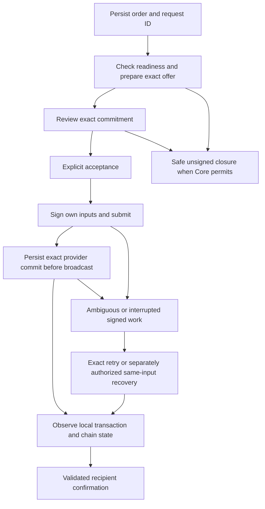

# Paymaster implementation

See [the developer guide](../PAYMASTER.md) for scope and documentation baseline.
The [client contract](digidollar-paymaster-integration.md) describes application use.

## Transaction and fee model

The result is an ordinary `DD_TX_TRANSFER`. The client supplies DD inputs and
the provider contributes DGB network-fee inputs. Each signs only its own inputs
after checking the complete transaction. Consensus and script checks remain
unchanged. There is one recipient; mint, redeem and batch sponsorship are absent.

Amounts are integer DD cents or DGB satoshis. Recipient bounds are
100..10,000,000 cents and user total is at most 10,000,000 cents. Provider terms
can narrow this range. The user-paid fee is rounded up:

```text
fee_cents = ceil(payment_cents * fee_rate_bps / 10000)
```

A positive `maximum_user_paid_service_fee_cents` caps that fee; zero means
uncapped by this provider setting. Independent client absolute, percentage
and rolling-day limits still apply. Public sponsorship charges zero DD fee.
Both models can be advertised by one identity with distinct offer IDs.

A nonzero fee below the minimum DD output needs a confirmed provider DD carrier.
The provider receives carrier principal plus fee; the principal is not charged
to the client. Free sponsorship does not need a carrier for a service fee.
All resulting DD outputs must still satisfy ordinary validation.

Fee deduction treats the entered amount as the exact total. Rounded cent gaps
fail with `PAYMASTER_NO_EXACT_GROSS_OFFER`, rather than silently changing that
total. Sweep uses spendable, unreserved inputs and the same authorization rules.

## Protocol sequence

1. Signed announcements enter a bounded directory. Clients filter amount,
   privacy, fee policy and local reliability information.
2. A dedicated Direct connection authenticates the expected provider against
   the local encrypted session, genesis and fresh challenge before revealing
   capacity/payment metadata.
3. Capacity admission precedes the full intent. Input-control proofs demonstrate
   control without authorizing the collaborative payment.
4. The exact quote binds provider, recipient, model, inputs/outputs, service
   fee, expiry and authorization commitment.
5. Explicit client acceptance permits signing/submission. The provider checks
   the exact manifest, authorization, inputs, budgets and transaction before
   signing its inputs and broadcasting.
6. Both parties reconcile local chain/mempool observations. Lost replies use
   durable replay/status, not another payment.

Protocol version is 6; unchanged legacy Direct layouts accept version 5 only
where explicitly supported. Signed offers/negotiation use the current format.
Wallet record versions are independent of wire versions. Compatibility does
not permit substituting unauthenticated transport for required channel proofs.
Announcements last up to 600 seconds; quote default/maximum is 60 seconds.
An announcement may become unavailable before expiry. Expiry does not prove
already signed spending authority harmless.

## Durable state and recovery

The client persists a canonical request ID/order. Identical concurrent retries
join it; material changes using the same ID fail. Sessions, reservations, exact
commit evidence, budgets and final observations are persisted with their state
transitions. Network/UI status alone must not release protected inputs.

Unsigned cancellation closes only work proven unsigned. Late responses cannot
revive approval after closure. Signed or ambiguous work remains protected and
exposes only Core-permitted actions. Cancel-to-self is an on-chain recovery
transaction, not an undo guarantee: the original transaction can still win.

Recovery fee exposure is retained through the 240-confirmation reorganization
safety depth. A winning original payment is accounted once. Retained exact
commit evidence can validate historical execution after rolling ledger entries
expire, without authorizing new work or recreating budget.

Provider admission is bounded at 8,192 retained sessions. Each cleanup pass
removes at most 64 eligible expired unsigned sessions after their retry/capacity
window plus retention interval. Signed, ambiguous and protected history is not
discarded to admit new work.

## Wallet lifecycle

Protected DGB/DD reserves are excluded from ordinary coin selection and shown
separately from available funds; wallet total includes them. Manual locks and
DD collateral remain distinct. Finite setup and recurring refill have separate
approvals. Refill may fund fewer complete slots, never deliberately partial
slots, and confirmed free capacity remains usable below the refill target.
See [pool setup](digidollar-paymaster-pool-setup.md).

Canonical wallet history/index checks remain prerequisites. Automatic work
belongs to the daemon; Qt/CLI control the same persisted state. Restoration
sets a durable guard before load callbacks, and an independent checkpoint
helps detect stale wallet copies. See the [threat model](paymaster-threat-model.md).

## Source ownership

| Paths | Responsibility |
|---|---|
| `src/paymaster/types.*`, `protocol.*`, `wire.*` | Typed records, commitments, bounded serialization. |
| `src/paymaster/txbuilder.*`, `psbt.*` | Exact transaction/PSBT construction and validation. |
| `src/paymaster/provider.*`, `provider_policy.*`, `reservation.*`, `sponsorship.*` | Admission, budgets, reservations, sponsorship. |
| `src/paymaster/client.*`, `directory.*`, `reputation.*`, `recovery.*`, `validation.*` | Discovery, selection, verification, retries/recovery. |
| `src/paymaster/manager.*`, `transport.h`, `src/net.*`, `src/netbase.*` | Direct channels, queues and connection budgets. |
| `src/wallet/paymasteridentity.*`, `paymasterpsbt.*`, `paymasterprovider.*` | Wallet keys, signatures and worker. |
| `src/wallet/paymasterstore*`, `paymasterdb.cpp`, `paymastercheckpoint.*` | Atomic state, accounting, reconciliation, rollback protection. |
| `src/wallet/rpc/paymaster*.cpp` | Wallet RPC orchestration and grouped implementations. |
| `src/rpc/paymaster.cpp`, `src/rpc/digidollar.cpp` | Node configuration, diagnostics, directory/send entry points. |
| `src/paymaster/setup.*`, `cli.*` | Shared setup decisions and interactive CLI. |
| `src/qt/paymasterwidget.*`, `paymastersendwidget.*`, `paymasterwallet.*`, `paymasteramount.*` | Provider/send UI, wallet adapter and amounts. |

Store code is split into provider/client/finalization/recovery/reconciliation/
reputation units; RPC code into provider/client/discovery/processing/runtime/
integration/send units. Review callers and shared helpers together.

## Lifecycle at the authorization boundaries

This is a conceptual review diagram, not a list of serialized state names.
Actual session/attempt/phase enums live in `src/paymaster/reservation.h`; RPC
views and permitted actions are derived in `src/wallet/rpc/paymaster_client.cpp`.



These boundaries explain the conservative UI behavior: input reservation can
precede payment approval, and signatures can exist despite a lost reply. A
provider's cached announcement, admitted capacity, exact quote, signed commit
and confirmed payment are separate artifacts. Timeout or UI cancellation must
not collapse them into one success/failure flag. The detailed
[client contract](digidollar-paymaster-integration.md) specifies API decisions.

## Change ownership and verification

| Task | Start with these sources | Check alongside the change |
|---|---|---|
| Fee arithmetic or exact gross amount | `src/paymaster/provider_policy.cpp`, `txbuilder.cpp`, `client.cpp` | Cent rounding, carrier output validity, client percentage/absolute/day limits, deducted-fee and sweep cases. |
| High-level payment API or retries | `src/wallet/rpc/paymaster_send.cpp`, `paymaster_integration.cpp`, `paymaster_client.cpp` | Same-ID replay, commitment acceptance, lost replies, terminal/pruned records and confirmed-recipient status. |
| Persistence or recovery | `src/wallet/paymasterstore*.cpp`, `paymasterdb.cpp`, `paymastercheckpoint.cpp` | Atomic failure/reopen, retained authority, reorg, restore and stale-copy cases. |
| Provider settings or startup | `src/paymaster/setup.cpp`, `cli.cpp`, `src/wallet/rpc/paymaster_provider.cpp`, `paymaster_runtime.cpp` | Shared GUI/CLI policy, unlock, persistent pause, startup/history waits and read-back of saved state. |
| Pool/refill | `src/wallet/paymasterprovider.cpp`, `paymasterstore_provider.cpp`, `src/wallet/rpc/paymaster_provider.cpp` | Both assets, complete slots, finite versus recurring approval, fees and usable capacity below target. |
| Direct networking | `src/paymaster/manager.cpp`, `transport.h`, `wire.cpp`, `src/net.cpp` | Identity/session proof, early disclosure, quotas, ordinary P2P capacity and privacy-preserving retry. |
| Client/provider UI | `src/qt/paymastersendwidget.cpp`, `paymasterwidget.cpp`, `paymasterwallet.cpp`, surrounding DD widgets | Unknown/loading states, wallet-bound asynchronous replies, cancellation, affordability and exact approval. |
| Built-in help/config docs | `src/paymaster/help.h`, `src/init.cpp`, `src/digibyte-cli.cpp`, RPC registrations | Correct executable/context, real parameter names, no help-only command registered as a node argument. |

Consult the [test coverage map](digidollar-paymaster-testing.md#coverage-map)
for suites and the [integration boundaries](design/paymaster-integration-boundaries.md)
for shared DigiByte code. Paths in a row are starting points, not permission to
ignore their callers. Persisted/wire changes require reader/version/fixture
review; changing only a GUI string must not create a new financial rule.

## Glossary

| Term | Meaning |
|---|---|
| Announcement / listing | Signed, expiring discovery information; not a reservation or guarantee. |
| Capacity admission | Current protocol evidence/admission for a request before full intent disclosure. |
| Quote / exact offer | Provider terms and resources bound to the transaction/authorization. |
| Commitment | Exact authorization binding; neither a nominal fee ceiling nor a transport acknowledgment. |
| Session / attempt | Durable client order versus a particular provider attempt within its permitted lifecycle. |
| Pool slot / target | Protected resource allocation versus desired maintained capacity; not all pool capital is ordinary available balance. |
| Final commit | Retained exact signed transaction and related durable authority/accounting. |
| Confirmation / recovery | Local chain evidence of recipient payment versus a competing return-to-self outcome. |
