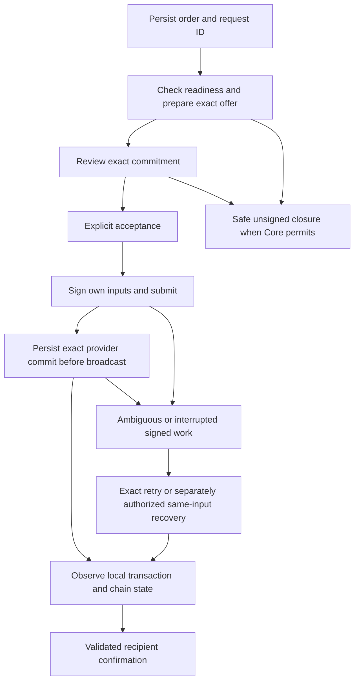

# Paymaster implementation

See [the developer guide](../PAYMASTER.md) for scope and documentation baseline.
The [client contract](digidollar-paymaster-integration.md) describes application use.

## Transaction and fee model

The result is an ordinary `DD_TX_TRANSFER`. The client supplies DD inputs and
the provider contributes DGB network-fee inputs. Each signs only its own inputs
after checking the complete transaction. Consensus and script checks remain
unchanged. There is one recipient; mint, redeem and batch sponsorship are absent.

Amounts are integer DD cents or DGB satoshis. Recipient bounds are
100..10,000,000 cents and user total is at most 10,000,000 cents. Provider terms
can narrow this range. The user-paid fee is rounded up:

```text
fee_cents = ceil(payment_cents * fee_rate_bps / 10000)
```

A positive `maximum_user_paid_service_fee_cents` caps that fee; zero means
uncapped by this provider setting. Independent client absolute, percentage
and rolling-day limits still apply. Public sponsorship charges zero DD fee.
Both models can be advertised by one identity with distinct offer IDs.

`GetProviderNetworkFee` supplies the current executable fee (0.1 DGB) for both
quote builders and readiness. A lower advertised cap cannot serve new work.
Readiness intersects each model's current safety budget with its own usable
pool resources: paid service needs DGB and carrier slots; sponsorship needs
DGB only. A carrier shortage in a mixed policy leaves sponsorship available.

A nonzero fee below the minimum DD output needs a confirmed provider DD carrier.
The provider receives carrier principal plus fee; the principal is not charged
to the client. Free sponsorship does not need a carrier for a service fee.
All resulting DD outputs must still satisfy ordinary validation.

Fee deduction treats the entered amount as the exact total. Rounded cent gaps
fail with `PAYMASTER_NO_EXACT_GROSS_OFFER`, rather than silently changing that
total. Sweep uses spendable, unreserved inputs and the same authorization rules.

## Protocol sequence

1. Signed announcements enter a bounded directory. Clients filter amount,
   privacy, fee policy and local reliability information.
2. A dedicated Direct connection authenticates the expected provider against
   the local encrypted session, genesis and fresh challenge before revealing
   capacity/payment metadata.
3. Capacity admission precedes the full intent. Input-control proofs demonstrate
   control without authorizing the collaborative payment.
4. The exact quote binds provider, recipient, model, inputs/outputs, service
   fee, expiry and authorization commitment.
5. Explicit client acceptance permits signing/submission. The provider checks
   the exact manifest, authorization, inputs, budgets and transaction before
   signing its inputs and broadcasting.
6. Both parties reconcile local chain/mempool observations. Lost replies use
   durable replay/status, not another payment.

The shared PSBT/final validator checks the actual canonical 64-byte Taproot
key-path witness for `SIGHASH_DEFAULT`, even when the PSBT retains an explicit
default-sighash field. Metadata cannot override a final signature's hash mode.

Protocol version is 6; unchanged legacy Direct layouts accept version 5 only
where explicitly supported. Signed offers/negotiation use the current format.
Wallet record versions are independent of wire versions. Compatibility does
not permit substituting unauthenticated transport for required channel proofs.
Request IDs use the shared 36-byte UUID decoding limit in Direct, intent,
recovery and persisted authority records. Oversized lengths fail before string
allocation; valid V5/V6 and record serialization bytes are unchanged.
Announcements last up to 600 seconds; quote default/maximum is 60 seconds.
An announcement may become unavailable before expiry. Expiry does not prove
already signed spending authority harmless.

Offer comparisons share `OfferCandidateLess` in `src/paymaster/client.cpp`.
Within the selected policy, non-deprioritized offers precede deprioritized ones;
cost precedes sufficient reliability data, success rate, known/lower latency
and provider/offer IDs. Fixed-total comparisons use lower fee then higher
recipient amount. Unknown reliability/latency have explicit positions so sorting
remains a strict order for every input permutation.

## Endpoint diagnostics

`IsSupportedPaymasterEndpoint` defines the common IPv4/IPv6/Tor, nonzero-port
and routability contract for announcements, offers, restricted descriptors,
readiness, diagnostics and Direct connection admission. Regtest explicitly
permits loopback. Unsupported networks are rejected before connection work;
ordinary P2P keeps its existing network support and budgets.

Endpoint diagnostics are separate from authenticated payment channels.
`checkpaymasterendpoint` uses a locally selected `DirectPurpose::DIAGNOSTIC` key,
which cannot alias a payment/recovery lease. It records V2 and capability
negotiation and finishes with `TRANSPORT_READY`, never authenticated `READY`.
The sender and receive handlers prohibit authentication/application messages on
these connections. They share the existing connection quotas, deadlines and
SOCKS5 privacy rules; they never reserve wallet capital. See the
[RPC diagnostic instructions](digidollar-paymaster.md#start-and-verify-mainnet-operation).

## Durable state and recovery

The client persists a canonical request ID/order. New public orders also retain
an independently versioned `pmclientorder` replay record with the original fee
cap, selection, attempt limit, amount semantics and ordered inputs. Its hash and
session/intent bindings are validated before exposing `resume_order`; it grants
no acceptance or signing authority. Missing legacy or unreadable replay metadata
does not hide signed payment/recovery observations. Qt never reconstructs it from
compose defaults; existing integrations can still replay their saved exact arguments.
Identical concurrent retries join it; material changes using the same ID fail.
Sessions, reservations, exact
commit evidence, budgets and final observations are persisted with their state
transitions. Network/UI status alone must not release protected inputs.

Authorization-bearing transitions share
`CommitWithPaymasterAuthorizationProtection`: the mandatory
`WALLET_FLAG_PAYMASTER_AUTHORIZATION` downgrade fence is written in the same
`WalletBatch` transaction, then published to memory only after commit. This
includes the first alternative-provider recovery signature and exact final
replay repair. Existing checkpoint preparation/commit ordering remains intact.
Unsigned cancellation and recovery expiry/pruning require readable, absent
independent authority records before releasing financial bindings; unknown
versions and read failures cannot substitute for absence.
The same session-wide check covers client quote expiry, unsigned abandonment
and fallback, including idempotent success paths and every historical attempt.
It also checks self/alternative recovery authority. Accepted unsigned terms and
authentic negative terminal results alone do not imply a payment signature.

The persisted quote is authenticated again before acceptance or signing through
`DecodePaymasterAuthorizationArtifacts`, shared with provider execution and
client final validation. It checks the provider signature, canonical encoding
and exact transaction/template bindings. Current approval and expiry checks
remain with the caller so intact historical final evidence stays verifiable.
Saved provider-signed result envelopes use the single domain decoder
`DecodeProviderSignedResultEnvelope` for store and execution validation.

Every new payment signature checks a fresh clock after acquiring the final
wallet lock. Local persisted authority and fee policy are reloaded there;
client signatures are persisted before releasing that lock. Chainstate/index
validation stays outside it. The role-limited signer checks the supplied
deadline again immediately before `FillPSBT`.

For normal provider payments, the first durable USER acceptance must precede
capacity expiry and be within the quote deadline. An exact accepted retry uses
the receipt's authenticated `accepted_at` for historical capacity validation,
and the current clock for `retry_until`, current wallet policy, budget, pool
bindings, manual locks and chain resources. This permits completing a timely
accepted payment after the short capacity TTL. Alternative recovery has no
equivalent durable provider receipt/retry window and still requires a current
response and capacity admission for every new provider signature.

Private Direct connections carry the existing destination-redaction policy
through TCP connection errors as well as SOCKS5 errors. Ordinary connection
logging retains its destination and unchanged socket behavior.

Normal and alternative-recovery client results use scoped inbox leases. Local
read, preflight or database failures retain the received artifact; acknowledgement
follows durable acceptance. Proven invalid remote envelopes are discarded without
releasing spending authority. A later broadcast failure uses the saved final bytes.
Unsigned recovery quotes also use scoped leases: local request damage, index,
template or persistence failures retain the reply; acknowledgement follows its
durable acceptance. Their ordinary quote/inbox expiry still applies. The extended
authenticated retention described below applies to complete signed results.
Persisted predecessor results and recovery authority are authenticated before
they can justify rejecting an incoming result. An intact accepted recovery
manifest can authenticate retention while another local recovery artifact is damaged.
After authenticating the expected provider and the wallet's own commit binding,
the exact queue incarnation remains protected beyond the transport TTL, including
between failed processing calls. It still consumes the existing inbox byte/count
quotas. This retention is in memory; restart continues to rely on durable evidence
and the existing provider replay/recovery paths.

Unsigned cancellation closes only work proven unsigned. Late responses cannot
revive approval after closure. Signed or ambiguous work remains protected and
exposes only Core-permitted actions. Cancel-to-self is an on-chain recovery
transaction, not an undo guarantee: the original transaction can still win.
Recovery quote expiry applies to unsigned preparation. `USER_SIGNED` and
`FINAL_COMMITTED` remain observable and resumable through Core-permitted actions
after that deadline; Qt must not request fresh approval for the saved signature.

Alternative recovery prices the aggregate original DD inputs and deducts its
fee from wallet-owned returns. The ordinary recipient-plus-fee ceiling does
not limit that aggregate; each return and fee output retains its ordinary DD
limits. Both parties use the same checked, rounded fee calculation. After the
canonical exact-final preflight, already spent recovery prevouts are supplied
only in a disposable reconstruction view. This requires an opaque, transient
proof bound to the exact transaction/witness, chainstate and observed tip;
presence enums or persisted bytes cannot manufacture it. A changed tip requires
a fresh preflight without holding the chain lock across index waits.
Full manifest and final-witness
validation remains mandatory; new signing still requires unspent inputs.
When a recovery result is missing, the client uses the same local final lookup
as ordinary submit retry. An exact wallet/mempool/chain transaction can supply
the transient proof after complete recovery-template and witness validation,
including after quote expiry. The client retries the persisted submit unchanged;
it retains `USER_SIGNED`, input protection and fee reservations until the
authenticated provider result is committed. Local presence is not a signed result.

Recovery fee exposure is retained through the 240-confirmation reorganization
safety depth. A winning original payment is accounted once. Retained exact
commit evidence can validate historical execution after rolling ledger entries
expire, without authorizing new work or recreating budget.

Normal provider sessions and active alternative provider recoveries share an admission
limit of 8,192 records. Exact existing retries do not consume another
record. Each cleanup pass removes at most 64 eligible unsigned records of each
kind after all saved retry/capacity deadlines and the 24-hour replay retention
interval. Recovery pruning revalidates the saved shape, absence of signed/commit
evidence and released pool/budget bindings before its atomic deletion.
At 240 confirmations, maintenance can atomically move at most 64 fully validated
provider recovery finals into `pmaltarchive`, with a `pmaltlocator` consistency
marker. Admission, drain and expiry scans visit active records only. Exact replay
and finance reconstruction point-read the full evidence using the recovery ID
already bound by the authoritative commit's `quote_id`; they revalidate that
binding. The marker grants no authority, and missing/corrupt/unsupported archived
evidence fails closed. Signed, ambiguous and protected history is not discarded
to admit new work. Archival bounds active work, not total on-disk history.

Capacity-response cleanup uses count- and byte-bounded database range pages and
a disposable wallet-database-scoped continuation. Failed pages restart without
publishing progress. After authenticating the proof and its nonce/session indexes,
cleanup can remove replay-cache rows after capacity expiry plus the 24-hour
retry window and 60-second quote clock allowance, including rows whose normal
owner was pruned or recovery owner archived. It never releases pool inputs or
fee reservations on that basis. Actual unsigned nonce-reservation release remains
a separate operation vetoed by either owner family and validated against current
pool and budget records. Drain work point-reads only live reserved admissions.

Tip/periodic session reconciliation, unsigned quote expiry, capacity-snapshot
compaction and recovery expiry use independent disposable continuations. Session
pages scan at most 64 rows and 512 KiB before filtering; record pages also bound
raw rows and bytes before their canonical point reads. A failed maintenance page
does not publish progress. Cleanup is eventual across pages. Cursors never prove
absence of authorization or grant releases: unsigned client release still makes
the complete independent recovery-evidence check. That financial proof, cold
index reconstruction and startup recovery remain complete operations.
Periodic durable rebroadcast pages provider commits, signed attempts and client
finals; validation then uses the transaction-to-session index to reload only
matching sessions. Exact manifests, signatures, chain preflight and reorg/pruning
checks remain mandatory.

## Wallet lifecycle

Protected DGB/DD reserves are excluded from ordinary coin selection and shown
separately from available funds; wallet total includes them. Manual locks and
DD collateral remain distinct. A reservation adds its own coin-lock reason;
cancel, expiry and pruning remove only that reason after a successful commit.
An explicit manual lock set during the reservation survives cleanup, including
wallet reload when persistent. Ordinary unlock removes only ordinary ownership.
Provider readiness and new operational-slot selection exclude ordinary/manual
locks. The signing boundary checks them again before creating a provider signature;
its own Paymaster reservation lock does not veto that signature. Exact durable
signature replay remains available without creating new authority.
The existing `lockedutxo` key retains `'1'` for ordinary locks; `'P'` and `'B'`
represent Paymaster and shared ownership. Legacy ambiguous `'1'` rows remain
conservatively locked until explicitly unlocked. Invalid values fail wallet load
and cannot be rewritten by cleanup. Finite setup and recurring refill have separate
approvals. Refill may fund fewer complete slots, never deliberately partial
slots, and confirmed free capacity remains usable below the refill target.
`ProviderSetupAuthorization` retains a monotone setup generation and revocation
independently of prunable maintenance history. Journal V2 requires that intact
record; authentic V1 journals remain readable and upgrade atomically on write.
Older binaries reject V2. New setup previews bind the generation; retained
accepted plans can replay exact work, while canceled or pruned plans cannot
become fresh spending authority. Finite and recurring admission share bounded
terminal-history pruning without dropping unresolved signatures.
Finite funding and automatic refill require wallet broadcasting before creating
a new funding signature. Automatic refill also checks before reserving a new
plan. Saved older unsubmitted automatic maintenance transactions remain protected
and are reported as awaiting broadcast,
separately from transactions observed in a relay pool awaiting confirmation.
See [pool setup](digidollar-paymaster-pool-setup.md).
Funded DD plans are revalidated through `ValidateDigiDollarTransferPlan` under
the execution wallet lock before building/signing. It reuses DD selection,
ordinary fee-coin availability and capacity/fee preflight for the exact saved
inputs; a different free input cannot make a stale selection spendable. The
explicit retirement exception applies to DD pool inputs, never manual DGB locks.
Finite setup, recurring refill, carrier withdrawal and retirement execute through
`ExecuteProviderMaintenanceTransactions`. Its typed authority reloads current
approval and exact outputs under `cs_wallet`; every explicit DD and DGB source
must pass the same ordinary-lock veto before a new signature. Retirement builds
both legs and checks fees before opening the checkpoint. The common operation
owns commit, DD tracking/history and journal/budget/pool accounting; a possible
partial commit retains its fence. Ordinary explicit coin-control semantics are
unchanged. Payment, recovery and provider control proofs reuse
`SignPaymasterBip86Control` for ownership, BIP86 tweak and digest signing; callers
retain their domain-separated hashes and protocol bindings.
`GetDDBalanceSummary().availability_known` distinguishes unavailable safety
classification from known zero spendable/reserved amounts. Owned confirmed and
pending totals remain independent; Qt and setup funding views preserve that
distinction.
CLI and Qt use `CalculateSetupCapital` for checked reserve amounts. Paid-refill
approval requires a complete current provider offer; Qt binds its reviewed fee
basis and liquidity revision atomically with `expected_provider_policy_hash`
and `expected_revision` on `setpaymasterliquiditypolicy`.

Maintenance reconciliation keeps record timestamps and the ledger accounting
high-water mark monotonic. Saved policy revisions can advance accounting time
beyond the wall clock, as can a later clock correction. Recovering a transaction,
observing confirmation or a conflict must preserve that time floor; otherwise
completed reserve work can fail validation and incorrectly block capital release.
Wall-clock expiry checks remain separate from accounting timestamps.
Pool refresh and refill planning read and update their current authoritative
records within one wallet-lock interval. A caller's status snapshot cannot
replace newer reservations. Unknown maintenance transaction IDs use a derived
wallet-history cache with at most 256 transaction observations per call. New
wallet transactions, rehashes and unnotified insertions invalidate or update
that observation. Until the scan finishes, `PAYMASTER_MAINTENANCE_RECONCILING`
prevents new refill signatures and unsigned release; known transaction IDs
continue to reconcile. Cache matches are checked against the complete journal.
Conflicted or abandoned maintenance with a saved transaction ID remains open:
its signatures can become usable again. All maintenance kinds follow that exact
transaction and restore their own invalidated successor outputs atomically on
its return. Source inputs retain their operation reservation while signatures
remain unresolved, including failed withdrawals. Refresh, readiness and both
native slot-admission paths exclude these journal-bound sources even if an older
pool snapshot marked them available; unrelated free slots remain usable.
Both provider signing paths repeat the same journal check under the signing
lock, covering quotes created by an older wallet before this protection.
The known fee, or conservatively the approved maximum when unknown,
remains in the outstanding budget and is not pruned while unresolved. No new
signature or replacement authority is inferred from that recovery.
RPC maintenance-budget totals and new reservations share
`SummarizeProviderMaintenanceBudget` at that same time floor. Planned and live
broadcast exposure does not age out; confirmed spend uses rolling windows.

Canonical wallet history/index checks remain prerequisites. Automatic work
belongs to the daemon; Qt/CLI control the same persisted state. Restoration
sets a durable guard before load callbacks, and an independent checkpoint
helps detect stale wallet copies. See the [threat model](paymaster-threat-model.md).

Direct provider Submit RPCs hold the same work guard as the network dispatcher,
including during validation, new signing, commit and broadcast. Stop priority
therefore covers both entry points. Exact durable replay does not start service
or create a new signature.

Carrier refill and withdrawal construct and validate their exact signed DD
transaction and fee under the final wallet lock before opening the independent
checkpoint operation. The pending marker begins immediately before wallet
commit/accounting. A rejected stale plan leaves no pending operation; failures
after a possible commit retain the conservative fence.

Before native commit, the wallet atomically saves `pmnativeexec` version 1 with
the exact signed legs, fee/history metadata and complete before/after pool and
maintenance accounting. Its immutable hash is the external pending-checkpoint
token. Startup and maintenance reconciliation call
`ResumeProviderMaintenanceTransactions`: validate the journal, identity, absence
of a restore guard, exact accounting snapshot and independent checkpoint, then
commit/rebroadcast only those bytes without signing. Pool and budget changes are
atomic; history and finance use their existing idempotent APIs. A wallet entry
left in memory by a failed transaction write is persisted again before completion.
The journal also protects every signed input from ordinary wallet selection.

Only the immediately adjacent interrupted checkpoint commit can be repaired,
with the same journal hash and an exact accounting snapshot. Completion erases
the journal and clears the pending marker in one wallet transaction. Stale clones,
missing/future/corrupt journals, divergent accounting and legacy pending markers
without exact signed work remain fenced. The checkpoint file layout stays at
version 2. Known abandoned, conflicted or unrecognized wallet transactions also
retain the journal and fence; recovery does not change those states to inactive.
Its OS lock, flush and high-water ordering are unchanged.
Keep a compatible build while native work is pending: earlier builds do not
implement this journal's recovery or ordinary fee-input protection.

Policy and pool setters initialize records only after a status-bearing read
proves `NOT_FOUND`. Read errors and unsupported versions preserve budgets, pool
reservations and checkpoint state. Finite setup cancellation, selected maintenance
cancellation, obsolete/downsized refill replacement and capital release share
the reserve-funding wrapper of `PreparePaymasterMaintenanceRelease`. Carrier
withdrawal preview replacement and expired withdrawal release use its separate
withdrawal mode, which also binds every reserved source carrier. Selected records
must be planned and unsigned, with no native execution journal, signed sibling,
wallet source spend or output using their scripts. The complete wallet proof
includes partial, conflicted and abandoned matches and does not depend on a
background history page completing. Each caller retains its own policy/revocation
consequences and atomic write of the released budget and source reservations.

Checkpoint file reads hold the same per-path recursive mutex as atomic file replacement
for the complete read-handle lifetime. On Windows, a CRT reader otherwise can
deny replacement and make an unrelated wallet transaction fail its commit.
Wallet-row reads finish before this file-only lock is acquired; database and
checkpoint rollback protections still apply independently. A short registry lock
only locates shared states; it performs no file/database I/O. Paths come from the
single cached network data directory and the genesis/provider filename, normalized
before lookup, so wallet clones share the same file lock. The OS lock, flush,
rename and checkpoint-before-database-commit ordering remain mandatory.
`WalletBatch` routes successful commit, abort and destruction through
`PaymasterWalletTransactionEnd`. That common completion publishes or discards
derived session/finance notifications and then releases checkpoint state;
`PaymasterCheckpointEnd` owns only the checkpoint lifetime.

## Derived indexes and finance storage

A wallet-scoped final/recovery transaction index is reconstructed from sessions
once and updated only after a successful wallet transaction. Aborts invalidate it.
A match triggers point reads and exact artifact validation; the index cannot grant
payment permission. Corruption invalidates the lookup and forces reconstruction.

Finance v2 stores immutable event identities individually, with transaction/time
indexes, checked daily contributions and versioned totals/revision metadata in the
existing wallet database. Wallet keys, balances and signed artifacts are not
migrated by this change. Migration, accounting and page-consistency requirements
are defined in the [operator guide](digidollar-paymaster-operator.md#finance-storage-and-page-consistency).
Alternative-provider recovery commits book their own income and cost atomically
and reconstruct from validated recovery records, without incrementing recipient
payment counts. Maintenance accounting uses exact wallet transaction fees;
source-bound corrections rebuild derived totals atomically while ordinary event
writes continue to enforce immutable economics.
Normal transfer event preparation, reconstruction and incremental updates use
`ValidateProviderCommitArtifacts` before reading manifest economics. It validates
the exact signed quote, manifest, template, provider inputs and all final witnesses,
including genesis and provider identity. Historical expiry or a conflicted chain
observation does not revoke this evidence. Execution adds its own lifecycle/time
gates; a historical finance observation grants no signing or broadcast authority.

Pagination uses bounded ordered database cursors. A full reconstruction runs on
first use after load, restore or invalidation. Thereafter wallet transaction
notifications and committed Paymaster source changes enqueue affected IDs; each
pass handles at most 256 jobs, including bounded transaction-index pages. Failed
commits retain pending work. Reports return `PAYMASTER_FINANCE_RECONCILING` while
work remains; a reader retries the query and never treats stale totals as current.
Committed pruning removes the erased attempt/commit bindings from the warm
finance cache. Aborted erases publish nothing. Immutable finance events and their
queued observation work survive pruning, so subsequent reports and reorg updates
do not require a deleted commit. Cold reconstruction follows the same retained
event contract.
Cursor filters and revisions still require a navigation restart after changes.
Full reconstruction validates immutable event sources independently of derived
aggregates and atomically repairs time, transaction and day indexes and totals.
Unknown record versions and damaged sources remain unavailable. Warm reports
and transaction reconciliation compare bounded pages against committed source
observations; missing index rows invalidate the cache and require reconstruction.
Failed maintenance with a saved transaction ID remains visible as open work.
The compact `getpaymasterinfo.finance_summary` shares the native report's
metadata/source-cache consistency check. A mismatched total or event count is
unavailable and invalidates derived state; it is never presented as known zero.

## Execution and presentation

RPC and background callers invoke the same native services with typed inputs and
results (`wallet/paymasterresults.h`). JSON encoding belongs to
`wallet/rpc/paymaster_results.cpp`; session snapshots are captured before encoding.
Financial guards remain inside those services, including restart/replay checks.
RPC and Qt preserve the [structured failure contract](digidollar-paymaster-integration.md#structured-execution-failures).
Finance snapshots preserve pool and maintenance read statuses: an unreadable
record is a failed observation, never an absent record or known zero capital.
Qt revokes observed actions and reviewed approvals on read/decode failure while
retaining request identity and financial artifacts. A fresh valid observation
restores actions. Reputation get/clear adapters distinguish absent history from
unreadable or unsupported persisted history; only absence returns an empty result.
Typed finalization classification preserves the narrower pre-commit retry set
and the additional retryable storage/observation failures for durable results.

Client quote/payment entry points coordinate named call-local phases for saved
authorization, offer selection, reservation, capacity, quote exchange and exact
approval. The connection lease remains owned across those phases; only the store
changes durable authority. Provider submit dispatch similarly separates intake,
replay, signing/commit and post-commit broadcast while retaining one work guard
and fair message lease. AUTO funding decisions belong to the native client
service. A new AUTO order with suitable own DGB is rejected before signing and
requires an explicit ordinary DGB send; it has no durable direct-payment manifest.
Qt presents that rejection only after read-only confirmation that the request
has no session, then lets the user explicitly select Own DGB and review again.
An uncertain recovery reply clears live approvals and continuations and keeps
polling the same request read-only; it never automatically repeats recovery.

Provider processing has one native disposition: no message, processed, rejected
or deferred. Delivery remains an optional separate observation. The RPC adapter
maps the disposition to the existing `processed`, `rejected` and `deferred`
fields; a signed negative payment result is distinct from local message rejection.

Provider processing distinguishes permanent peer errors from local uncertainty.
An unknown recovery ID, mismatched binding, invalid submitted PSBT/signature or
divergent replay is acknowledged only for that message: the local result is
`processed=true`, `rejected=true`, `queued=false`, with a stable `rejection_reason`.
Normal submits also use that local rejection for expired unsigned quotes and
retry windows after validating the saved authority. A retained provider signature
or final commit still follows its exact replay firewall after expiry.
No new signed rejection is sent and no budget, reservation, pool, final bytes or
checkpoint is released or reset. Read/version errors, corrupt persisted records
or templates, missing indexed sessions, readiness/unlock/checkpoint failures and
uncertain chain/index reads retain the message. A failed quote prevout lookup
is permanent only when the active UTXO view proves the input absent or spent.
For persisted authorization, exact artifact bindings are checked before deeper
manifest validation. A PSBT changed independently of its signed quote reports
`PAYMASTER_PROVIDER_AUTHORIZATION_ARTIFACT_CONFLICT`; coherently bound artifacts
can instead reach the sighash or manifest checks. All are local failures and
retain the inbound message and durable authority.

Each submit-processing call dispatches at most one message. The manager
alternates normal and recovery submits per provider when both types are queued,
falling back immediately when one type is empty. Acquiring the dispatch lease
advances this ephemeral type cursor even if processing later retains the
message; no acknowledgement or financial transition is implied. The existing
netgroup/session selector uses independent dispatch cursors within each type,
so another type's acknowledgement cannot reset its rotation. With both types
pending, each gets a turn within two eligible calls; readiness and local
authorization checks still decide whether that turn can complete.

Request processing shares that bounded dispatcher, with separate provider-local
cursors for capacity, recovery and quote requests. Each call leases at most one
eligible message; three continuously queued eligible types each receive a turn
within three calls. Fresh capacity is excluded while readiness permits only
continuations. A throttled capacity request remains queued and returns its
deferral; the next call can advance a different type. Dispatch and acknowledgement
never change reservations or authorize a payment.

Service scheduling distinguishes new capacity, admitted request continuations
and submissions. Pending finite pool preparation suppresses new capacity while
allowing admitted work to reach its ordinary execution checks. Synchronization,
unlock, restore and exact signing authority are still checked at execution.

`GetAlternativeRecoveryByIdWithStatus` preserves the database read status;
stored recovery shape is validated before interpreting nested bindings.
Recovery requests pass separate replay, preflight and commit phases. Permanent
peer defects are consumed without faulting the automatic service or blocking
later quote/submit work. `GetProviderCapacityProofWithStatus` distinguishes a
missing, mismatched or expired request from damaged local indexes, response
bytes and signatures; the latter remain for reconciliation. Ordinary quote
classification also retains these local failures. An index lookup failure is
not proof of a missing remote prevout unless the active UTXO view establishes it.
`ValidateAlternativeRecoverySubmitPayload` checks peer bindings, canonical PSBT
encoding and signatures against a previously validated local template. It does
not replace the full chainstate validation or the checks immediately before signing.

Automatic provider execution and durable-commit broadcast preflights never wait
for transaction-index notifications on the shared validation scheduler. A tip
change after the pre-commit check must not make the scheduler wait on itself.

The generic `qt/walletasync.*` queue admits two concurrent pure reads. A mutation
waits for earlier reads and blocks subsequent work until completion. Callers
declare effects explicitly; unclassified work is a non-coalescible mutation.
Opted-in identical reads coalesce only within the same mutation generation.
Signing preflight, unlock,
execution and relock share one mutation slot. Cancelling the UI cannot cancel an
already-started wallet operation or authorize its repetition. Wallet generations
invalidate late replies; shutdown joins started workers before destroying their
dependencies. Provider components own their panel state and workflows; the send
controller owns session transitions and emits effects for the widget to execute.
Both reuse shared formatting and backend financial rules.
Finance and automation observations are captured by typed wallet services before
RPC serialization, using one observation time. The finance capture owns wallet
synchronization, reconciliation and the locked accounting snapshot; its result
distinguishes a report from a failure without using JSON as an intermediate model.
`CaptureProviderLifecycleStatus` supplies both provider status RPCs, start results,
daemon start waiting and automation observations. It combines enabled settings,
autostart, volatile one-shot intent, runtime state, wallet lock and persisted worker
status. Disabled providers report stopped; an enabled pending one-shot start can
report waiting without changing autostart. Capturing status performs no work or
authority mutation; each caller retains its existing reconciliation behavior.
`ClientModel` owns node-status reads through the same generic queue, also in
wallet-disabled Qt builds. Its destructor drains started reads before Core can
destroy indexes, oracle state or chainstate. DD Overview callbacks retain their
structured RPC errors and generation checks.

The setup wizard's private `SetupExecution` owns one frozen choice/step plan.
Named observation, execution, funding-review and completion stages replace
captured continuation chains. Every late reply checks the owner, wizard,
wallet generation and privacy state before accessing controls or starting work;
retry resumes the same failed step. Finance CSV uses ungrouped exact decimal
amounts; display-only thousands grouping never enters numeric export columns.
Qt policy defaults and resets read the same `SetupDefaultPolicy` proposal as the
CLI. A numeric policy reset preserves the selected funding model; restoring the
funding model is a separate action.

Pool-preparation request bindings now hash typed recovery mappings with the local
`Pool Request v2` tag, independent of JSON formatting. This is a local preview/replay
binding, not a signed network message. Previously approved work remains journaled
and is reconciled by its exact transaction; a stale preview must be reviewed again.
No signed transaction or spending limit is rewritten.

## Source ownership

The [source map](../REPO_MAP_DIGIDOLLAR.md#paymaster-network) owns the module
inventory; the [layer contract](design/paymaster-integration-boundaries.md#dependency-and-reuse-contract)
defines permitted dependencies. Wallet services own financial decisions, RPCs
adapt parameters/results, and Qt controllers/views manage interaction. Review
the shared implementation together with all callers when changing a rule.

## Lifecycle at the authorization boundaries

This is a conceptual review diagram, not a list of serialized state names.
Actual session/attempt/phase enums live in `src/paymaster/reservation.h`; RPC
views and permitted actions are derived in `src/wallet/paymasterclientview.cpp`.
They carry an observation time; execution reloads the current records and validates
authority again. An observation never grants permission to sign.



These boundaries explain the conservative UI behavior: input reservation can
precede payment approval, and signatures can exist despite a lost reply. A
provider's cached announcement, admitted capacity, exact quote, signed commit
and confirmed payment are separate artifacts. Timeout or UI cancellation must
not collapse them into one success/failure flag. The detailed
[client contract](digidollar-paymaster-integration.md) specifies API decisions.

## Change ownership and verification

| Task | Start with these sources | Check alongside the change |
|---|---|---|
| Fee arithmetic or exact gross amount | `src/paymaster/types.cpp`, `provider_policy.cpp`, `txbuilder.cpp`, `client.cpp` | Shared fee/carrier arithmetic at each trust boundary; cent rounding, carrier output validity, client percentage/absolute/day limits, deducted-fee and sweep cases. |
| High-level payment API or retries | `src/wallet/paymasterclient.cpp`, `paymasterclientview.cpp`, `paymasterrecoveryservice.cpp`; RPC send adapter | Durable identity, exact approval, replay and recipient-confirmation semantics. |
| Persistence or recovery | `src/wallet/paymasterstore*.cpp`, `paymasterdb.cpp`, `paymastercheckpoint.cpp`, `paymasterfinance.cpp` | Atomicity, retained authority, migration, reorg and stale-copy protection. |
| Provider settings, startup or stop | `src/wallet/paymasterconfiguration.cpp`, `paymasterservice.cpp`, `paymasterintegration.cpp` | Work exclusion, readiness, persistent pause, unlock and failure cleanup. |
| Pool/refill and capital release | `src/wallet/paymasterproviderops.cpp`, `paymasterpool.cpp`, `paymasterprovider.cpp` | Exact plans, finite versus recurring approval, signed-work guards and atomic cancellation/release. |
| Direct networking | `src/paymaster/manager.cpp`, `transport.h`, `wire.cpp`, `src/net.cpp` | Identity/session proof, disclosure, quotas and ordinary P2P capacity. |
| Client/provider UI | `src/qt/paymastersendcontroller.cpp`, `paymasterprovider_*.cpp`, `paymasterasync.cpp`, `paymasterwallet.cpp` | Snapshot/error handling, wallet switch/shutdown, unlock lifetime and exact approval. |
| Built-in help/config docs | `src/paymaster/help.h`, `src/init.cpp`, `src/digibyte-cli.cpp`, RPC registrations | Correct executable/context, real parameter names, no help-only command registered as a node argument. |

Consult the [test coverage map](digidollar-paymaster-testing.md#coverage-map)
for suites and the [integration boundaries](design/paymaster-integration-boundaries.md)
for shared DigiByte code. Paths in a row are starting points, not permission to
ignore their callers. Persisted/wire changes require reader/version/fixture
review; changing only a GUI string must not create a new financial rule.

## Glossary

| Term | Meaning |
|---|---|
| Announcement / listing | Signed, expiring discovery information; not a reservation or guarantee. |
| Capacity admission | Current protocol evidence/admission for a request before full intent disclosure. |
| Quote / exact offer | Provider terms and resources bound to the transaction/authorization. |
| Commitment | Exact authorization binding; neither a nominal fee ceiling nor a transport acknowledgment. |
| Session / attempt | Durable client order versus a particular provider attempt within its permitted lifecycle. |
| Pool slot / target | Protected resource allocation versus desired maintained capacity; not all pool capital is ordinary available balance. |
| Final commit | Retained exact signed transaction and related durable authority/accounting. |
| Confirmation / recovery | Local chain evidence of recipient payment versus a competing return-to-self outcome. |
