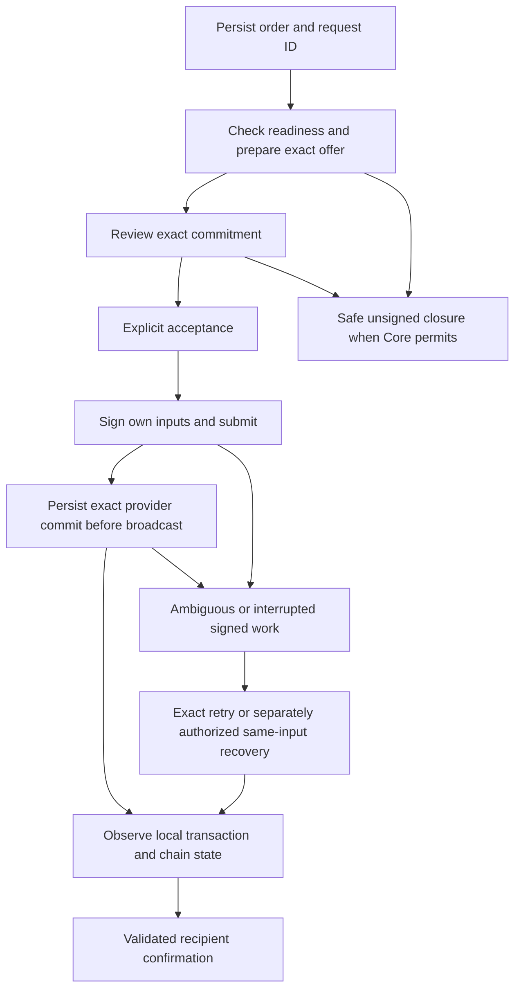

# Paymaster implementation

See [the developer guide](../PAYMASTER.md) for scope and documentation baseline.
The [client contract](digidollar-paymaster-integration.md) describes application use.

## Transaction and fee model

The result is an ordinary `DD_TX_TRANSFER`. The client supplies DD inputs and
the provider contributes DGB network-fee inputs. Each signs only its own inputs
after checking the complete transaction. Consensus and script checks remain
unchanged. There is one recipient; mint, redeem and batch sponsorship are absent.

Amounts are integer DD cents or DGB satoshis. Recipient bounds are
100..10,000,000 cents and user total is at most 10,000,000 cents. Provider terms
can narrow this range. The user-paid fee is rounded up:

```text
fee_cents = ceil(payment_cents * fee_rate_bps / 10000)
```

A positive `maximum_user_paid_service_fee_cents` caps that fee; zero means
uncapped by this provider setting. Independent client absolute, percentage
and rolling-day limits still apply. Public sponsorship charges zero DD fee.
Both models can be advertised by one identity with distinct offer IDs.

A nonzero fee below the minimum DD output needs a confirmed provider DD carrier.
The provider receives carrier principal plus fee; the principal is not charged
to the client. Free sponsorship does not need a carrier for a service fee.
All resulting DD outputs must still satisfy ordinary validation.

Fee deduction treats the entered amount as the exact total. Rounded cent gaps
fail with `PAYMASTER_NO_EXACT_GROSS_OFFER`, rather than silently changing that
total. Sweep uses spendable, unreserved inputs and the same authorization rules.

## Protocol sequence

1. Signed announcements enter a bounded directory. Clients filter amount,
   privacy, fee policy and local reliability information.
2. A dedicated Direct connection authenticates the expected provider against
   the local encrypted session, genesis and fresh challenge before revealing
   capacity/payment metadata.
3. Capacity admission precedes the full intent. Input-control proofs demonstrate
   control without authorizing the collaborative payment.
4. The exact quote binds provider, recipient, model, inputs/outputs, service
   fee, expiry and authorization commitment.
5. Explicit client acceptance permits signing/submission. The provider checks
   the exact manifest, authorization, inputs, budgets and transaction before
   signing its inputs and broadcasting.
6. Both parties reconcile local chain/mempool observations. Lost replies use
   durable replay/status, not another payment.

The shared PSBT/final validator checks the actual canonical 64-byte Taproot
key-path witness for `SIGHASH_DEFAULT`, even when the PSBT retains an explicit
default-sighash field. Metadata cannot override a final signature's hash mode.

Protocol version is 6; unchanged legacy Direct layouts accept version 5 only
where explicitly supported. Signed offers/negotiation use the current format.
Wallet record versions are independent of wire versions. Compatibility does
not permit substituting unauthenticated transport for required channel proofs.
Announcements last up to 600 seconds; quote default/maximum is 60 seconds.
An announcement may become unavailable before expiry. Expiry does not prove
already signed spending authority harmless.

Offer comparisons share `OfferCandidateLess` in `src/paymaster/client.cpp`.
Within the selected policy, non-deprioritized offers precede deprioritized ones;
cost precedes sufficient reliability data, success rate, known/lower latency
and provider/offer IDs. Fixed-total comparisons use lower fee then higher
recipient amount. Unknown reliability/latency have explicit positions so sorting
remains a strict order for every input permutation.

## Endpoint diagnostics

Endpoint diagnostics are separate from authenticated payment channels.
`checkpaymasterendpoint` uses a locally selected `DirectPurpose::DIAGNOSTIC` key,
which cannot alias a payment/recovery lease. It records V2 and capability
negotiation and finishes with `TRANSPORT_READY`, never authenticated `READY`.
The sender and receive handlers prohibit authentication/application messages on
these connections. They share the existing connection quotas, deadlines and
SOCKS5 privacy rules; they never reserve wallet capital. See the
[RPC diagnostic instructions](digidollar-paymaster.md#start-and-verify-mainnet-operation).

## Durable state and recovery

The client persists a canonical request ID/order. Identical concurrent retries
join it; material changes using the same ID fail. Sessions, reservations, exact
commit evidence, budgets and final observations are persisted with their state
transitions. Network/UI status alone must not release protected inputs.

The persisted quote is authenticated again before acceptance or signing through
`DecodePaymasterAuthorizationArtifacts`, shared with provider execution and
client final validation. It checks the provider signature, canonical encoding
and exact transaction/template bindings. Current approval and expiry checks
remain with the caller so intact historical final evidence stays verifiable.

Normal and alternative-recovery client results use scoped inbox leases. Local
read, preflight or database failures retain the received artifact; acknowledgement
follows durable acceptance. Proven invalid remote envelopes are discarded without
releasing spending authority. A later broadcast failure uses the saved final bytes.
After authenticating the expected provider and the wallet's own commit binding,
the exact queue incarnation remains protected beyond the transport TTL, including
between failed processing calls. It still consumes the existing inbox byte/count
quotas. This retention is in memory; restart continues to rely on durable evidence
and the existing provider replay/recovery paths.

Unsigned cancellation closes only work proven unsigned. Late responses cannot
revive approval after closure. Signed or ambiguous work remains protected and
exposes only Core-permitted actions. Cancel-to-self is an on-chain recovery
transaction, not an undo guarantee: the original transaction can still win.
Recovery quote expiry applies to unsigned preparation. `USER_SIGNED` and
`FINAL_COMMITTED` remain observable and resumable through Core-permitted actions
after that deadline; Qt must not request fresh approval for the saved signature.

Recovery fee exposure is retained through the 240-confirmation reorganization
safety depth. A winning original payment is accounted once. Retained exact
commit evidence can validate historical execution after rolling ledger entries
expire, without authorizing new work or recreating budget.

Normal provider sessions and alternative provider recoveries share an admission
limit of 8,192 retained records. Exact existing retries do not consume another
record. Each cleanup pass removes at most 64 eligible unsigned records of each
kind after all saved retry/capacity deadlines and the 24-hour replay retention
interval. Recovery pruning revalidates the saved shape, absence of signed/commit
evidence and released pool/budget bindings before its atomic deletion. Signed,
ambiguous and protected history is not discarded to admit new work.

## Wallet lifecycle

Protected DGB/DD reserves are excluded from ordinary coin selection and shown
separately from available funds; wallet total includes them. Manual locks and
DD collateral remain distinct. A reservation adds its own coin-lock reason;
cancel, expiry and pruning remove only that reason after a successful commit.
An explicit manual lock set during the reservation survives cleanup, including
wallet reload when persistent. Ordinary unlock removes only ordinary ownership.
Provider readiness and new operational-slot selection exclude ordinary/manual
locks. The signing boundary checks them again before creating a provider signature;
its own Paymaster reservation lock does not veto that signature. Exact durable
signature replay remains available without creating new authority.
The existing `lockedutxo` key retains `'1'` for ordinary locks; `'P'` and `'B'`
represent Paymaster and shared ownership. Legacy ambiguous `'1'` rows remain
conservatively locked until explicitly unlocked. Invalid values fail wallet load
and cannot be rewritten by cleanup. Finite setup and recurring refill have separate
approvals. Refill may fund fewer complete slots, never deliberately partial
slots, and confirmed free capacity remains usable below the refill target.
See [pool setup](digidollar-paymaster-pool-setup.md).

Maintenance reconciliation keeps record timestamps and the ledger accounting
high-water mark monotonic. Saved policy revisions can advance accounting time
beyond the wall clock, as can a later clock correction. Recovering a transaction,
observing confirmation or a conflict must preserve that time floor; otherwise
completed reserve work can fail validation and incorrectly block capital release.
Wall-clock expiry checks remain separate from accounting timestamps.
Conflicted or abandoned maintenance with a saved transaction ID remains open:
its signatures can become usable again. All maintenance kinds follow that exact
transaction and restore their own invalidated successor outputs atomically on
its return. The known fee, or conservatively the approved maximum when unknown,
remains in the outstanding budget and is not pruned while unresolved. No new
signature or replacement authority is inferred from that recovery.
RPC maintenance-budget totals and new reservations share
`SummarizeProviderMaintenanceBudget` at that same time floor. Planned and live
broadcast exposure does not age out; confirmed spend uses rolling windows.

Canonical wallet history/index checks remain prerequisites. Automatic work
belongs to the daemon; Qt/CLI control the same persisted state. Restoration
sets a durable guard before load callbacks, and an independent checkpoint
helps detect stale wallet copies. See the [threat model](paymaster-threat-model.md).

Checkpoint file reads hold the same per-path recursive mutex as atomic file replacement
for the complete read-handle lifetime. On Windows, a CRT reader otherwise can
deny replacement and make an unrelated wallet transaction fail its commit.
Wallet-row reads finish before this file-only lock is acquired; database and
checkpoint rollback protections still apply independently. A short registry lock
only locates shared states; it performs no file/database I/O. Paths come from the
single cached network data directory and the genesis/provider filename, normalized
before lookup, so wallet clones share the same file lock. The OS lock, flush,
rename and checkpoint-before-database-commit ordering remain mandatory.

## Derived indexes and finance storage

A wallet-scoped final/recovery transaction index is reconstructed from sessions
once and updated only after a successful wallet transaction. Aborts invalidate it.
A match triggers point reads and exact artifact validation; the index cannot grant
payment permission. Corruption invalidates the lookup and forces reconstruction.

Finance v2 stores immutable event identities individually, with transaction/time
indexes, checked daily contributions and versioned totals/revision metadata in the
existing wallet database. Wallet keys, balances and signed artifacts are not
migrated by this change. Migration, accounting and page-consistency requirements
are defined in the [operator guide](digidollar-paymaster-operator.md#finance-storage-and-page-consistency).

Pagination uses bounded ordered database cursors. A full reconstruction runs on
first use after load, restore or invalidation. Thereafter wallet transaction
notifications and committed Paymaster source changes enqueue affected IDs; each
pass handles at most 256 jobs, including bounded transaction-index pages. Failed
commits retain pending work. Reports return `PAYMASTER_FINANCE_RECONCILING` while
work remains; a reader retries the query and never treats stale totals as current.
Cursor filters and revisions still require a navigation restart after changes.

## Execution and presentation

RPC and background callers invoke the same native services with typed inputs and
results (`wallet/paymasterresults.h`). JSON encoding belongs to
`wallet/rpc/paymaster_results.cpp`; session snapshots are captured before encoding.
Financial guards remain inside those services, including restart/replay checks.
RPC and Qt preserve the [structured failure contract](digidollar-paymaster-integration.md#structured-execution-failures).

Client quote/payment entry points coordinate named call-local phases for saved
authorization, offer selection, reservation, capacity, quote exchange and exact
approval. The connection lease remains owned across those phases; only the store
changes durable authority. Provider submit dispatch similarly separates intake,
replay, signing/commit and post-commit broadcast while retaining one work guard
and fair message lease. AUTO funding decisions belong to the native client
service. A new AUTO order with suitable own DGB is rejected before signing and
requires an explicit ordinary DGB send; it has no durable direct-payment manifest.

Provider processing has one native disposition: no message, processed, rejected
or deferred. Delivery remains an optional separate observation. The RPC adapter
maps the disposition to the existing `processed`, `rejected` and `deferred`
fields; a signed negative payment result is distinct from local message rejection.

Provider processing distinguishes permanent peer errors from local uncertainty.
An unknown recovery ID, mismatched binding, invalid submitted PSBT/signature or
divergent replay is acknowledged only for that message: the local result is
`processed=true`, `rejected=true`, `queued=false`, with a stable `rejection_reason`.
Normal submits also use that local rejection for expired unsigned quotes and
retry windows after validating the saved authority. A retained provider signature
or final commit still follows its exact replay firewall after expiry.
No new signed rejection is sent and no budget, reservation, pool, final bytes or
checkpoint is released or reset. Read/version errors, corrupt persisted records
or templates, missing indexed sessions, readiness/unlock/checkpoint failures and
uncertain chain/index reads retain the message. A failed quote prevout lookup
is permanent only when the active UTXO view proves the input absent or spent.
For persisted authorization, exact artifact bindings are checked before deeper
manifest validation. A PSBT changed independently of its signed quote reports
`PAYMASTER_PROVIDER_AUTHORIZATION_ARTIFACT_CONFLICT`; coherently bound artifacts
can instead reach the sighash or manifest checks. All are local failures and
retain the inbound message and durable authority.

Each submit-processing call dispatches at most one message. The manager
alternates normal and recovery submits per provider when both types are queued,
falling back immediately when one type is empty. Acquiring the dispatch lease
advances this ephemeral type cursor even if processing later retains the
message; no acknowledgement or financial transition is implied. The existing
netgroup/session selector uses independent dispatch cursors within each type,
so another type's acknowledgement cannot reset its rotation. With both types
pending, each gets a turn within two eligible calls; readiness and local
authorization checks still decide whether that turn can complete.

Request processing shares that bounded dispatcher, with separate provider-local
cursors for capacity, recovery and quote requests. Each call leases at most one
eligible message; three continuously queued eligible types each receive a turn
within three calls. Fresh capacity is excluded while readiness permits only
continuations. A throttled capacity request remains queued and returns its
deferral; the next call can advance a different type. Dispatch and acknowledgement
never change reservations or authorize a payment.

`GetAlternativeRecoveryByIdWithStatus` preserves the database read status;
stored recovery shape is validated before interpreting nested bindings.
Recovery requests pass separate replay, preflight and commit phases. Permanent
peer defects are consumed without faulting the automatic service or blocking
later quote/submit work. `GetProviderCapacityProofWithStatus` distinguishes a
missing, mismatched or expired request from damaged local indexes, response
bytes and signatures; the latter remain for reconciliation. Ordinary quote
classification also retains these local failures. An index lookup failure is
not proof of a missing remote prevout unless the active UTXO view establishes it.
`ValidateAlternativeRecoverySubmitPayload` checks peer bindings, canonical PSBT
encoding and signatures against a previously validated local template. It does
not replace the full chainstate validation or the checks immediately before signing.

The generic `qt/walletasync.*` queue admits two concurrent pure reads. A mutation
waits for earlier reads and blocks subsequent work until completion. Callers
declare effects explicitly; unclassified work is a non-coalescible mutation.
Opted-in identical reads coalesce only within the same mutation generation.
Signing preflight, unlock,
execution and relock share one mutation slot. Cancelling the UI cannot cancel an
already-started wallet operation or authorize its repetition. Wallet generations
invalidate late replies; shutdown joins started workers before destroying their
dependencies. Provider components own their panel state and workflows; the send
controller owns session transitions and emits effects for the widget to execute.
Both reuse shared formatting and backend financial rules.
Finance and automation observations are captured by typed wallet services before
RPC serialization, using one observation time. The finance capture owns wallet
synchronization, reconciliation and the locked accounting snapshot; its result
distinguishes a report from a failure without using JSON as an intermediate model.
`ClientModel` owns node-status reads through the same generic queue, also in
wallet-disabled Qt builds. Its destructor drains started reads before Core can
destroy indexes, oracle state or chainstate. DD Overview callbacks retain their
structured RPC errors and generation checks.

The setup wizard's private `SetupExecution` owns one frozen choice/step plan.
Named observation, execution, funding-review and completion stages replace
captured continuation chains. Every late reply checks the owner, wizard,
wallet generation and privacy state before accessing controls or starting work;
retry resumes the same failed step. Finance CSV uses ungrouped exact decimal
amounts; display-only thousands grouping never enters numeric export columns.
Qt policy defaults and resets read the same `SetupDefaultPolicy` proposal as the
CLI. A numeric policy reset preserves the selected funding model; restoring the
funding model is a separate action.

Pool-preparation request bindings now hash typed recovery mappings with the local
`Pool Request v2` tag, independent of JSON formatting. This is a local preview/replay
binding, not a signed network message. Previously approved work remains journaled
and is reconciled by its exact transaction; a stale preview must be reviewed again.
No signed transaction or spending limit is rewritten.

## Source ownership

The [source map](../REPO_MAP_DIGIDOLLAR.md#paymaster-network) owns the module
inventory; the [layer contract](design/paymaster-integration-boundaries.md#dependency-and-reuse-contract)
defines permitted dependencies. Wallet services own financial decisions, RPCs
adapt parameters/results, and Qt controllers/views manage interaction. Review
the shared implementation together with all callers when changing a rule.

## Lifecycle at the authorization boundaries

This is a conceptual review diagram, not a list of serialized state names.
Actual session/attempt/phase enums live in `src/paymaster/reservation.h`; RPC
views and permitted actions are derived in `src/wallet/paymasterclientview.cpp`.
They carry an observation time; execution reloads the current records and validates
authority again. An observation never grants permission to sign.



These boundaries explain the conservative UI behavior: input reservation can
precede payment approval, and signatures can exist despite a lost reply. A
provider's cached announcement, admitted capacity, exact quote, signed commit
and confirmed payment are separate artifacts. Timeout or UI cancellation must
not collapse them into one success/failure flag. The detailed
[client contract](digidollar-paymaster-integration.md) specifies API decisions.

## Change ownership and verification

| Task | Start with these sources | Check alongside the change |
|---|---|---|
| Fee arithmetic or exact gross amount | `src/paymaster/types.cpp`, `provider_policy.cpp`, `txbuilder.cpp`, `client.cpp` | Shared fee/carrier arithmetic at each trust boundary; cent rounding, carrier output validity, client percentage/absolute/day limits, deducted-fee and sweep cases. |
| High-level payment API or retries | `src/wallet/paymasterclient.cpp`, `paymasterclientview.cpp`, `paymasterrecoveryservice.cpp`; RPC send adapter | Durable identity, exact approval, replay and recipient-confirmation semantics. |
| Persistence or recovery | `src/wallet/paymasterstore*.cpp`, `paymasterdb.cpp`, `paymastercheckpoint.cpp`, `paymasterfinance.cpp` | Atomicity, retained authority, migration, reorg and stale-copy protection. |
| Provider settings, startup or stop | `src/wallet/paymasterconfiguration.cpp`, `paymasterservice.cpp`, `paymasterintegration.cpp` | Work exclusion, readiness, persistent pause, unlock and failure cleanup. |
| Pool/refill and capital release | `src/wallet/paymasterproviderops.cpp`, `paymasterpool.cpp`, `paymasterprovider.cpp` | Exact plans, finite versus recurring approval, signed-work guards and atomic cancellation/release. |
| Direct networking | `src/paymaster/manager.cpp`, `transport.h`, `wire.cpp`, `src/net.cpp` | Identity/session proof, disclosure, quotas and ordinary P2P capacity. |
| Client/provider UI | `src/qt/paymastersendcontroller.cpp`, `paymasterprovider_*.cpp`, `paymasterasync.cpp`, `paymasterwallet.cpp` | Snapshot/error handling, wallet switch/shutdown, unlock lifetime and exact approval. |
| Built-in help/config docs | `src/paymaster/help.h`, `src/init.cpp`, `src/digibyte-cli.cpp`, RPC registrations | Correct executable/context, real parameter names, no help-only command registered as a node argument. |

Consult the [test coverage map](digidollar-paymaster-testing.md#coverage-map)
for suites and the [integration boundaries](design/paymaster-integration-boundaries.md)
for shared DigiByte code. Paths in a row are starting points, not permission to
ignore their callers. Persisted/wire changes require reader/version/fixture
review; changing only a GUI string must not create a new financial rule.

## Glossary

| Term | Meaning |
|---|---|
| Announcement / listing | Signed, expiring discovery information; not a reservation or guarantee. |
| Capacity admission | Current protocol evidence/admission for a request before full intent disclosure. |
| Quote / exact offer | Provider terms and resources bound to the transaction/authorization. |
| Commitment | Exact authorization binding; neither a nominal fee ceiling nor a transport acknowledgment. |
| Session / attempt | Durable client order versus a particular provider attempt within its permitted lifecycle. |
| Pool slot / target | Protected resource allocation versus desired maintained capacity; not all pool capital is ordinary available balance. |
| Final commit | Retained exact signed transaction and related durable authority/accounting. |
| Confirmation / recovery | Local chain evidence of recipient payment versus a competing return-to-self outcome. |
